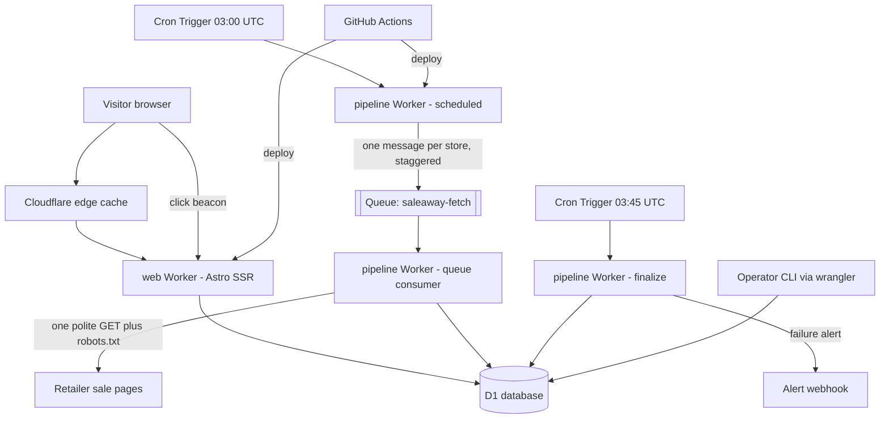
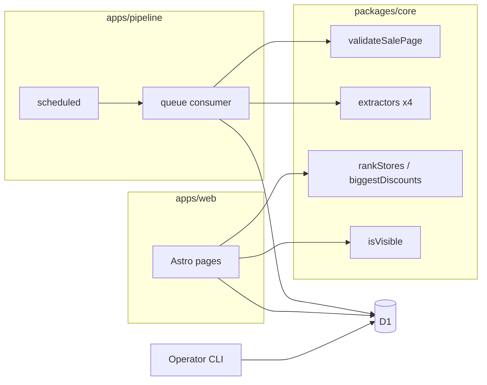
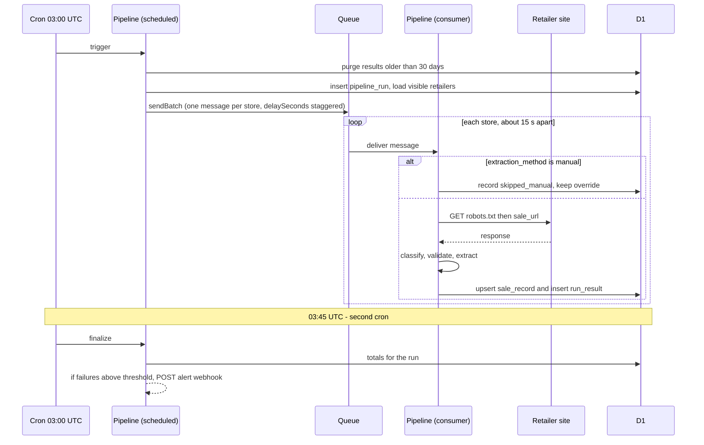
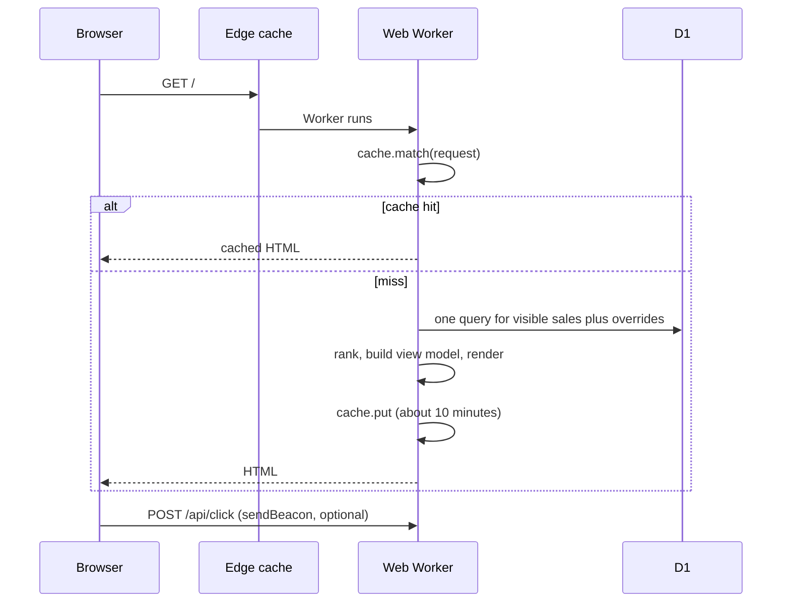
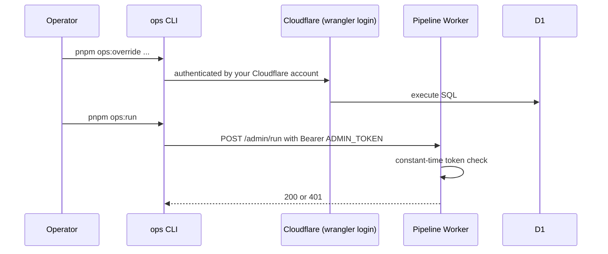
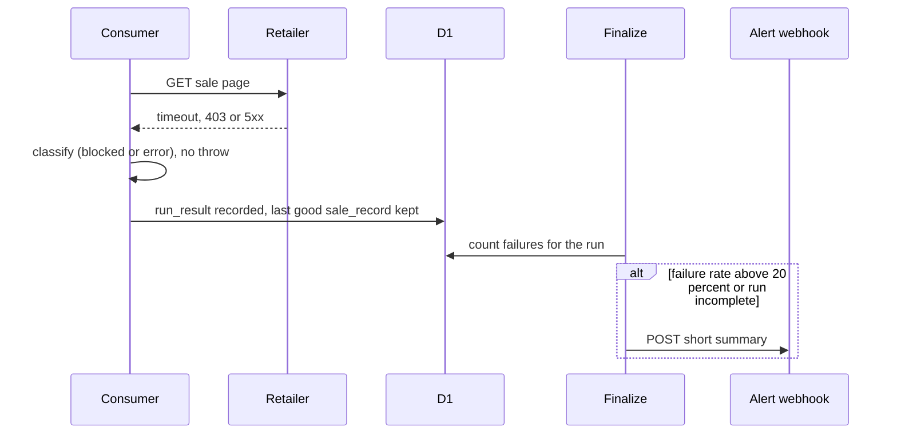

# Saleaway Fullstack Architecture Document

_Drafted by the Architect agent (Winston) in YOLO mode on 2026-10-29 from `docs/prd.md`, `docs/front-end-spec.md`, `docs/brief.md`, `docs/fetch-spike.md` and `docs/data/`. Decisions were confirmed with the user on 2026-10-29 (see the Platform and Black Friday sections). Cloudflare limits were checked against the official Cloudflare documentation on 2026-10-29 and are listed in "Verified platform limits" below._

## Introduction

This document outlines the complete fullstack architecture for Saleaway, including backend systems, frontend implementation, and their integration. It serves as the single source of truth for AI-driven development, ensuring consistency across the entire technology stack.

### Starter Template or Existing Project

N/A - Greenfield project. The scaffold comes from `npm create cloudflare@latest` (Astro option) rather than a third-party starter.

### Change Log

| Date | Version | Description | Author |
|---|---|---|---|
| 2026-10-29 | 0.1 | First architecture draft, with verified Cloudflare limits | Winston (Architect) |
| 2026-10-29 | 0.2 | Decisions applied: Astro, stay on Cloudflare with GitHub Actions fallback runner, Black Friday tripwire | Winston (Architect) |

## Verified platform limits (Cloudflare Free plan, checked 2026-10-29)

These numbers shape the design. They come from the official Cloudflare docs pages for Workers limits, D1 limits and pricing, Queues pricing, Browser Rendering limits and static assets. Where a page was unclear, it is marked.

| Area | Free plan limit | Effect on Saleaway |
|---|---|---|
| Worker requests | 100,000 per day | Each page view that reaches a Worker counts. This caps the site at roughly 100k Worker-served requests a day (see Risk R3). |
| Subrequests per invocation | 50 | One cron run cannot fetch ~95 stores. Work is fanned out so each invocation handles one store. |
| CPU time per invocation | **10 ms** (HTTP requests and Cron Triggers) | The tightest limit. Parsing large pages may exceed it (see Risk R1). Waiting for a network response does not count as CPU time. |
| Cron Triggers | 5 per account, 15 minutes wall time | Two are used. |
| Queue consumer wall time | 15 minutes | Fine. A free-plan CPU limit for consumers was not stated on the page, so it is assumed to be 10 ms. |
| Queues | Available on Free: 10,000 operations per day, 24 hour retention | About 3 operations per store per day, so roughly 300 a day. |
| D1 | 500 MB per database, 5 GB per account, 10 databases, **5 million rows read per day, 100,000 rows written per day**, 50 queries per invocation, 100 bound parameters | Pipeline writes about 500 rows a day. Reads must be cached, so the home page cannot query D1 on every view. |
| Browser Rendering | 10 minutes of browser time per day, 3 concurrent browsers | Enough for only a handful of JavaScript-only stores a day (Epic 5). |
| Static assets | Free and unlimited per the docs. Whether they count toward the 100,000 requests a day was not stated. | CSS, JavaScript and fonts are served as static assets. |
| Worker bundle size | The Workers limits page summary read "64 MiB uncompressed". The OpenNext docs state a **3 MiB compressed** Free limit. These disagree. | Treat 3 MiB compressed as the working limit. **Measured in Story 1.2 (2026-10-29):** the web Worker deployed at 614.85 KiB total, 159.00 KiB gzip (about 5% of 3 MiB), and the Free plan accepted it. No limit was reached, so the disagreement is not settled. See `docs/spike-s0-workers-dev.md`. |

**Next.js on Cloudflare (relevant to the framework choice):** Cloudflare's current Next.js guide recommends "vinext", a beta Vite plugin, as the default path. The OpenNext Cloudflare adapter is the other route, and its docs reference a 1.0 beta migration and the 3 MiB compressed Free limit. Both paths are beta or in flux.

## Platform decision (2026-10-29)

**Stay on Cloudflare. Do not move the whole project to another platform.**

| Option | Verdict | Why |
|---|---|---|
| **Cloudflare Workers + D1 (chosen)** | Keep | Free, global edge, cron and queues included, and the only real constraint (10 ms CPU) affects one part of the system, the pipeline. |
| Vercel (free Hobby plan) | No | As I understand it, the Hobby plan is for non-commercial use, and an ad-funded site is commercial. Confirm in their terms if you want to be sure. |
| Netlify free | No | Function and build-minute allowances are small, and it has no cron-plus-queue pipeline or database included. |
| Render | No | Free web services sleep when idle, cron jobs are paid, and the free Postgres database expires. |
| Cheap VPS (about 4 euros a month) or Oracle Cloud free VM | Not now | No CPU limit and one machine for everything, but you maintain it yourself (updates, security, backups), and a VPS is not free. A reasonable later move if the site outgrows Cloudflare Free. |

**The weak spot is the pipeline, not the website.** The website (cached pages, one database query) is light work that suits Cloudflare's edge. Parsing big retailer pages is the heavy work that could exceed 10 ms.

**Fallback runner: GitHub Actions (free).** If spike S1 shows big pages exceed 10 ms, keep everything on Cloudflare but run the fetch-and-extract step as a scheduled GitHub Actions workflow instead of the queue consumer:

- It has no 10 ms CPU limit, and a normal Node.js process can parse a 1.6 MB page without trouble.
- It can run a real browser (Playwright) to read JavaScript-only stores. That avoids Cloudflare Browser Rendering's 10-minute daily cap and makes Epic 5 Story 5.1 much easier.
- It reuses `packages/core` unchanged, because that package does no I/O. This is the reason the logic is kept there.
- It writes results to the same D1 database through Wrangler or the Cloudflare API, so the website does not change.
- Caveats: scheduled workflows can start a few minutes late, GitHub pauses scheduled workflows on public repositories after 60 days without activity, and GitHub's IP ranges may be blocked by some retailers just as Cloudflare's may. Spike S2 will test both.

## High Level Architecture

### Technical Summary

Saleaway is a serverless system on Cloudflare's free tier, with two Workers sharing one D1 (SQLite) database in a TypeScript monorepo. A pipeline Worker runs once a day from a Cron Trigger, puts one message per store on a queue, and a queue consumer fetches, validates and extracts each store's discount politely and in isolation, writing a small fact record to D1. A web Worker built with Astro reads D1 and server-renders the home page (category cards of store rows, plus the "Biggest discounts today" card), behind an edge cache. Operators manage the system with CLI commands rather than an admin web app. The architecture fits the PRD's 3-day, no-budget constraints and keeps a clear path to scale.

### Platform and Infrastructure Choice

**Options considered**

1. **Cloudflare Workers + D1 + Queues (recommended).** Matches your hosting preference, free tier covers the MVP, one vendor, edge-served pages. Constraint: 10 ms CPU per invocation.
2. **Vercel + Supabase.** Easy Next.js hosting, but cron and function limits on free tiers are tight, and you asked for Cloudflare.
3. **Cloudflare Workers Paid ($5 a month).** Same design with far higher CPU and request limits. Not needed unless Risk R1 or R3 happens, and it is the clean escape hatch.

**Platform:** Cloudflare (Workers, D1, Queues, Web Analytics).
**Key Services:** Workers (web and pipeline), D1, Queues, Cron Triggers, Workers Logs, Web Analytics, GitHub Actions for CI/CD.
**Deployment Host and Regions:** Cloudflare's global edge. D1 primary location set to the closest region to South Africa that Cloudflare offers (a location hint, to be confirmed at database creation).

### Repository Structure

**Structure:** Monorepo.
**Monorepo Tool:** pnpm workspaces. No Nx or Turborepo, since there are only three packages.
**Package Organization:** `apps/web` (Astro site), `apps/pipeline` (cron and queue Worker), `packages/core` (pure, tested logic shared by both: validation, extraction, ranking, visibility rules and types), plus `db/` for migrations and seed data and `scripts/ops/` for operator commands.

### High Level Architecture Diagram



### Architectural Patterns

- **Serverless, event-driven fan-out:** cron enqueues, a consumer handles one store per invocation. _Rationale:_ stays inside the 50-subrequest and 10 ms CPU limits and isolates failures (NFR4).
- **Shared pure core package:** validation, extraction, ranking and visibility are plain functions with no I/O. _Rationale:_ testable with saved page samples (NFR12) and reusable by the web and pipeline Workers.
- **Strategy pattern per store:** `extraction_method` in the Retailers table picks the extractor. _Rationale:_ stores differ, and changing a store's method is a data change, not a release (FR3).
- **Facts only, no content copy:** the database stores name, URLs, percentage and timestamps. _Rationale:_ NFR7 legal safety.
- **Cache-aside at the edge:** home page HTML cached for minutes. _Rationale:_ protects the 5 million row-read and 100,000 request daily limits and meets the 2 second goal (NFR2).
- **Overrides as data:** manual values live in their own table and win at read time. _Rationale:_ the pipeline can never overwrite an operator's decision (FR12).
- **Computed visibility:** hiding stale or ended stores is done when reading, not by deleting rows. _Rationale:_ nothing is lost, and rules are unit-testable (Story 2.3).
- **CLI for operations:** no admin web UI. _Rationale:_ no extra attack surface and less to build in 3 days.

## Tech Stack

Exact versions were recorded in Story 1.1 on 2026-10-29 and are also pinned in the lockfile (`pnpm-lock.yaml`). Rows still marked "latest, pinned" are installed by the story that first needs them.

### Technology Stack Table

| Category | Technology | Version | Purpose | Rationale |
|---|---|---|---|---|
| Frontend Language | TypeScript | 5.9.3 (pinned in Story 1.1; 7.x exists but typescript-eslint does not support it yet) | Type-safe code across web, pipeline and core | One language end to end, shared types |
| Frontend Framework | Astro (SSR on Workers via `@astrojs/cloudflare`) | Astro 7.4.4 with @astrojs/cloudflare 14.4.3 (pinned in Story 1.1; needs Node 22.23.4 or newer) | Server-rendered pages with almost no client JavaScript | Decided 2026-10-29, see "Framework decision" below |
| UI Component Library | None. Astro components with hand-written CSS | - | Category card, store row, pill, chips, strip, ad slot | Spec has about 8 small components, and no library keeps the bundle small |
| State Management | None. Server-rendered. One small same-origin script file | - | Status strip dismiss, active chip, click beacon | No client state worth managing |
| Backend Language | TypeScript | same as above | Pipeline and web Workers | Same as above |
| Backend Framework | Cloudflare Workers runtime (no framework) | `compatibility_date` pinned at scaffold | Cron, queue consumer, admin run endpoint | Smallest possible footprint |
| API Style | No public API. Internal HTTP endpoints only (see below) | - | Click beacon, health check, manual pipeline run | The product is a website, not an API |
| Database | Cloudflare D1 (SQLite) | managed | Retailers, sale records, overrides, run log, clicks | Free tier, SQLite as you proposed, same platform |
| Cache | Cloudflare Cache API in the web Worker | managed | Cache rendered home page HTML | Protects D1 quotas and speeds up pages |
| File Storage | None at launch | - | No images or files stored | Text-only design (NFR7). R2 only if needed later |
| Authentication | None for visitors. Bearer token secret for the manual-run endpoint. Operator CLI uses your Cloudflare login | - | Protect operator actions | No user accounts in the MVP |
| Frontend Testing | Vitest + axe (via Playwright smoke test) | latest, pinned | Component logic, accessibility check of the built page | Spec requires automated axe checks |
| Backend Testing | Vitest with `@cloudflare/vitest-pool-workers` | Vitest 5.0.5 (pinned in Story 1.1; the Workers pool is added in the first story that needs it) | Unit tests with page samples, D1 integration tests | Runs the Worker code and D1 locally (NFR12) |
| E2E Testing | Playwright, smoke only (home loads, links present, axe) | latest, pinned | One or two checks | PRD: no full E2E suite for the MVP |
| Build Tool | pnpm + Astro build + Wrangler | pnpm 9.0.0, Astro 7.4.4, Wrangler 4.155.0 (pinned in Story 1.1) | Build and deploy | Standard for Cloudflare |
| Bundler | Vite (via Astro) and esbuild (via Wrangler) | managed | Bundle Workers | Defaults |
| IaC Tool | `wrangler.jsonc` per Worker, plus SQL migrations in `db/migrations` | - | Bindings, cron schedules, queues | Cloudflare config as code, no Terraform for 3 days |
| CI/CD | GitHub Actions | - | Lint, type check, test, deploy on push to main | Tests gate deploys (Story 4.4) |
| Monitoring | Workers Logs (observability enabled), Cloudflare Web Analytics, health CLI, failure alert webhook | - | Errors, traffic, system health | Free and cookie-free (NFR8). Confirm Workers Logs free allowance at scaffold |
| Logging | Structured JSON logger in `packages/core` | - | One log shape everywhere | NFR11 |
| Linting | ESLint with typescript-eslint and eslint-plugin-astro | ESLint 10.13.0, typescript-eslint 8.72.1, eslint-plugin-astro 3.2.1, @eslint/js 10.0.1 | `pnpm lint`, including no `console.log` outside the logger | Added in Story 1.1: the architecture named a lint command but no tool |
| Type check (web) | @astrojs/check | 0.9.12 | `astro check` in `pnpm typecheck` | Needed by Story 1.1 for the web app |
| Script runner | tsx | 4.23.15 (pinned in Story 1.3) | Runs the operator scripts in `scripts/ops`, for example `pnpm ops:seed` | The architecture names it for the ops scripts (Components, Operator CLI) |
| Node types | @types/node | 22.20.5 (pinned in Story 1.3; Node 22 line, matching `.nvmrc`) | Types for `node:fs`, `process` and similar in `scripts/ops` and the core tests | The repository had no Node types, so `pnpm typecheck` needed them |
| CSS Framework | None. CSS custom properties (design tokens) plus scoped component styles | - | Neo-brutalist style from the spec | Smaller than any framework |

### Framework decision (decided 2026-10-29: Astro)

You suggested Next.js and the PRD left the choice to the Architect. **You confirmed Astro**, for these reasons:

1. **Cloudflare's own Next.js path is still beta** (vinext, or the OpenNext adapter with a 1.0 beta migration), and the Free plan bundle limit is 3 MiB compressed. Astro's Cloudflare adapter is a standard supported path.
2. **The page is almost entirely static content.** Astro ships no JavaScript by default, which helps the 2-second goal, the Lighthouse targets and SEO.
3. **Three days is short.** A beta deploy path is the wrong place to spend a day debugging.

The rest of the architecture does not depend on the frontend framework: the web Worker, D1, the pipeline Worker and `packages/core` would work the same with another one.

## Data Models

### Category

**Purpose:** group stores into the 10 categories shown as cards.

**Key Attributes:**
- id: number - primary key
- slug: string - URL anchor, for example `sport`
- name: string - display name
- tagline: string - italic line under the card title
- sortOrder: number - card order
- colorToken: string - name of the colour tab token

```typescript
export interface Category {
  id: number;
  slug: string;
  name: string;
  tagline: string;
  sortOrder: number;
  colorToken: string;
}
```

**Relationships:**
- A category has many retailers.

### Retailer

**Purpose:** one row per store. Adding a store is one new row (FR3).

**Key Attributes:**
- slug: string - stable identifier, for example `crocs-sa`
- name: string - display name
- homepageUrl: string
- categoryId: number
- rank: number - approximate popularity rank from the spreadsheet, used for tie-breaks
- platform: string | null - for example `shopify`
- saleUrl: string | null - the hand-picked sale page
- blackFridayUrl: string | null, blackFridayVerified: boolean
- extractionMethod: `shopify_json` | `html` | `structured_data` | `manual`
- seedStatus: how the URL was found in the spreadsheet
- isVisible: boolean - operator switch (stores with no sale page start hidden)

```typescript
export type ExtractionMethod = 'shopify_json' | 'html' | 'structured_data' | 'manual';
export type SeedStatus =
  | 'verified_products' | 'verified_js_shell' | 'search_only' | 'no_sale_page';

export interface Retailer {
  id: number;
  slug: string;
  name: string;
  homepageUrl: string;
  categoryId: number;
  rank: number;
  platform: string | null;
  saleUrl: string | null;
  blackFridayUrl: string | null;
  blackFridayVerified: boolean;
  extractionMethod: ExtractionMethod;
  seedStatus: SeedStatus;
  isVisible: boolean;
}
```

**Relationships:**
- Belongs to one category.
- Has at most one current sale record, at most one override, and many run results.

### SaleRecord

**Purpose:** the current known state of a store's sale (FR9). Facts only, no retailer content (NFR7).

**Key Attributes:**
- retailerId: number
- state: `active` | `ended` | `unknown`
- validation: `content_verified` | `url_verified` | `none`
- discountPercent: number | null - deepest discount found
- lastResult: classification of the last fetch
- firstSeenAt, lastCheckedAt, lastValidatedAt, endedAt: timestamps (ISO 8601, UTC)

```typescript
export type FetchClass =
  | 'ok' | 'blocked' | 'not_found' | 'redirected_away' | 'js_only' | 'error' | 'skipped_manual';

export interface SaleRecord {
  retailerId: number;
  state: 'active' | 'ended' | 'unknown';
  validation: 'content_verified' | 'url_verified' | 'none';
  discountPercent: number | null;
  lastResult: FetchClass;
  firstSeenAt: string | null;
  lastCheckedAt: string | null;
  lastValidatedAt: string | null;
  endedAt: string | null;
}
```

**Relationships:**
- One per retailer. Updated in place by the pipeline.

### Override

**Purpose:** operator decisions that beat extracted data (FR12).

**Key Attributes:**
- retailerId: number
- discountPercent: number | null
- hide: boolean
- saleUrl: string | null
- expiresAt: string | null
- note: string

```typescript
export interface Override {
  retailerId: number;
  discountPercent: number | null;
  hide: boolean;
  saleUrl: string | null;
  expiresAt: string | null;
  note: string;
  createdAt: string;
}
```

**Relationships:**
- At most one per retailer. Ignored after `expiresAt`. Never touched by the pipeline.

### PipelineRun and RunResult

**Purpose:** the run log (FR11, FR21).

```typescript
export interface PipelineRun {
  id: number;
  startedAt: string;
  finishedAt: string | null;
  trigger: 'cron' | 'manual';
  storesTotal: number;
  storesOk: number;
  storesFailed: number;
}

export interface RunResult {
  id: number;
  runId: number;
  retailerId: number;
  result: FetchClass;
  httpStatus: number | null;
  discountPercent: number | null;
  durationMs: number;
  error: string | null;
  createdAt: string;
}
```

**Relationships:**
- A run has many results. Results older than 30 days are deleted at the start of each run (retention).

### ClickCount

**Purpose:** per-day click-outs per store for the KPI (FR19). Counters only, no personal data.

```typescript
export interface ClickCount {
  day: string;          // YYYY-MM-DD, UTC
  retailerId: number;
  clicks: number;
}
```

## API Specification

Saleaway has no public API. The only HTTP endpoints are internal, so no OpenAPI document is needed.

| Endpoint | Worker | Auth | Purpose |
|---|---|---|---|
| `GET /` and static pages | web | none | Server-rendered pages, edge-cached |
| `POST /api/click` | web | none, rate-limited by a sampling switch | Records a click-out for a store slug (FR19) |
| `GET /health` | web | none | Canary: returns `ok` (Story 1.1) |
| `POST /admin/run` | pipeline | `Authorization: Bearer <ADMIN_TOKEN>`, compared in constant time | Start a manual pipeline run (Story 3.1, AC6) |

`/api/click` validates that the slug exists and increments the day's counter. A `CLICK_SAMPLE_RATE` setting (default 1.0) can reduce writes if D1's 100,000 rows-written-per-day limit is at risk.

## Components

### Web Worker (`apps/web`)

**Responsibility:** render and serve the public site.

**Key Interfaces:**
- Pages: home, About, Privacy, Contact, plus `/health`.
- `getHomeViewModel(db)` returns category cards, the "Biggest discounts today" card and the status strip data.
- `POST /api/click`.

**Dependencies:** D1 (read-mostly), `packages/core` for ranking and visibility rules.

**Technology Stack:** Astro SSR on Workers, CSS tokens from `docs/front-end-spec.md`, Cache API.

### Pipeline Worker (`apps/pipeline`)

**Responsibility:** the daily discovery job in three entry points: `scheduled` (start a run and enqueue), `queue` (process one store), and a second `scheduled` (finalize the run and alert).

**Key Interfaces:**
- `scheduled(controller)` selects the entry by cron expression.
- `queue(batch)` handles one store per message.
- `fetch(request)` for `POST /admin/run` only.

**Dependencies:** D1, Queues, `packages/core`.

**Technology Stack:** TypeScript on Workers, `HTMLRewriter` or targeted parsing for HTML, `JSON.parse` for Shopify JSON.

### Core package (`packages/core`)

**Responsibility:** pure logic with no I/O: `classifyResponse`, `validateSalePage`, one extractor per method, `rankStores`, `isVisible`, `biggestDiscounts`, URL safety checks, the structured logger and shared types.

**Key Interfaces:** pure functions, each taking plain data and returning plain data.

**Dependencies:** none.

**Technology Stack:** TypeScript, Vitest.

### Operator CLI (`scripts/ops`)

**Responsibility:** the commands in Stories 1.3, 4.1, 4.2 and 4.3.

**Key Interfaces:** `pnpm ops:seed`, `pnpm ops:override`, `pnpm ops:health`, `pnpm ops:check-urls`, `pnpm ops:run` (calls `/admin/run`).

**Dependencies:** Wrangler (`wrangler d1 execute --remote`), authenticated by your Cloudflare login.

**Technology Stack:** TypeScript scripts run with `tsx`.

### Component Diagrams



## External APIs

### Retailer sale pages (public websites)

- **Purpose:** read each store's sale page to confirm a real sale and the deepest discount.
- **Documentation:** none. These are public web pages, not APIs.
- **Base URL(s):** the `sale_url` of each retailer.
- **Authentication:** none.
- **Rate Limits:** self-imposed. One page fetch per store per day, plus a robots.txt check, staggered over about 25 minutes (NFR6).

**Key Endpoints Used:**
- `GET {sale_url}` - the sale page.
- `GET {origin}/robots.txt` - checked before the page fetch.
- For Shopify stores: `GET {origin}/collections/{handle}/products.json?limit=...` - read was/now prices.

**Integration Notes:** the user-agent is `SaleawayBot/1.0 (+https://saleaway.co.za/contact)`. Only `https` URLs are fetched, redirects are limited to 3, and private or local addresses are rejected. No attempt is made to get around bot protection (NFR6). Three stores (Amazon.co.za, Game, Checkers) blocked even a home connection, so they default to `manual`.

### Cloudflare Web Analytics

- **Purpose:** cookie-free visit counts (FR19, NFR8).
- **Documentation:** Cloudflare dashboard.
- **Authentication:** a site token in the page.
- **Integration Notes:** one small script, permitted in the CSP.

### Ad network (later)

Not integrated in the MVP. The ad slots stay empty until an ad network approves the site (FR18). Adding ads will need CSP changes and a POPIA review.

## Core Workflows

### Daily pipeline



### State rules per fetch result

| Result | Effect on sale record |
|---|---|
| `ok` and validated with discounted products | `active`, `content_verified`, percentage set (or null for "On sale"), `last_validated_at` updated |
| `ok` but no discounted products | `ended`, `ended_at` set (FR10) |
| `js_only` (page loads but products render with JavaScript) | `active`, `url_verified`, shown as "On sale" |
| `blocked`, `error` | last good record is kept, only `last_checked_at` and `last_result` change |
| `not_found`, `redirected_away` | `ended` |

A record is hidden when it is `ended`, when its freshness time is older than 72 hours, or when an active override hides it. The **freshness time** is the latest of `last_validated_at`, the time an active override that sets a percentage was created, and, only for a store that has never been validated, the time the retailer row was created. Without that last part the site would be empty until the first pipeline run. These rules live in `isVisible` in `packages/core` and are built in Story 2.3, together with override precedence (an active override's percentage and sale URL replace the extracted ones).

### Page view



### Operator override

`pnpm ops:override --slug crocs-sa --percent 50 --expires 2026-11-30` writes one row to `overrides` through `wrangler d1 execute --remote`. The site reflects it when the cached page expires (about 10 minutes at most).

## Database Schema

```sql
-- db/migrations/0001_init.sql
CREATE TABLE categories (
  id          INTEGER PRIMARY KEY,
  slug        TEXT NOT NULL UNIQUE,
  name        TEXT NOT NULL,
  tagline     TEXT NOT NULL DEFAULT '',
  sort_order  INTEGER NOT NULL DEFAULT 0,
  color_token TEXT NOT NULL DEFAULT 'cat-default'
);

CREATE TABLE retailers (
  id                     INTEGER PRIMARY KEY,
  slug                   TEXT NOT NULL UNIQUE,
  name                   TEXT NOT NULL,
  homepage_url           TEXT NOT NULL,
  category_id            INTEGER NOT NULL REFERENCES categories(id),
  rank                   INTEGER NOT NULL DEFAULT 999,
  platform               TEXT,
  sale_url               TEXT,
  black_friday_url       TEXT,
  black_friday_verified  INTEGER NOT NULL DEFAULT 0 CHECK (black_friday_verified IN (0,1)),
  extraction_method      TEXT NOT NULL DEFAULT 'html'
    CHECK (extraction_method IN ('shopify_json','html','structured_data','manual')),
  seed_status            TEXT NOT NULL DEFAULT 'search_only'
    CHECK (seed_status IN ('verified_products','verified_js_shell','search_only','no_sale_page')),
  is_visible             INTEGER NOT NULL DEFAULT 1 CHECK (is_visible IN (0,1)),
  created_at             TEXT NOT NULL DEFAULT (strftime('%Y-%m-%dT%H:%M:%SZ','now')),
  updated_at             TEXT NOT NULL DEFAULT (strftime('%Y-%m-%dT%H:%M:%SZ','now'))
);
CREATE INDEX idx_retailers_category_rank ON retailers(category_id, rank);

CREATE TABLE sale_records (
  retailer_id       INTEGER PRIMARY KEY REFERENCES retailers(id),
  state             TEXT NOT NULL DEFAULT 'unknown' CHECK (state IN ('active','ended','unknown')),
  validation        TEXT NOT NULL DEFAULT 'none'
    CHECK (validation IN ('content_verified','url_verified','none')),
  discount_percent  INTEGER CHECK (discount_percent BETWEEN 5 AND 90),
  last_result       TEXT,
  first_seen_at     TEXT,
  last_checked_at   TEXT,
  last_validated_at TEXT,
  ended_at          TEXT
);

CREATE TABLE overrides (
  retailer_id      INTEGER PRIMARY KEY REFERENCES retailers(id),
  discount_percent INTEGER CHECK (discount_percent BETWEEN 1 AND 99),
  hide             INTEGER NOT NULL DEFAULT 0 CHECK (hide IN (0,1)),
  sale_url         TEXT,
  expires_at       TEXT,
  note             TEXT NOT NULL DEFAULT '',
  created_at       TEXT NOT NULL DEFAULT (strftime('%Y-%m-%dT%H:%M:%SZ','now'))
);

CREATE TABLE pipeline_runs (
  id            INTEGER PRIMARY KEY,
  started_at    TEXT NOT NULL,
  finished_at   TEXT,
  trigger       TEXT NOT NULL CHECK (trigger IN ('cron','manual')),
  stores_total  INTEGER NOT NULL DEFAULT 0,
  stores_ok     INTEGER NOT NULL DEFAULT 0,
  stores_failed INTEGER NOT NULL DEFAULT 0
);

CREATE TABLE run_results (
  id               INTEGER PRIMARY KEY,
  run_id           INTEGER NOT NULL REFERENCES pipeline_runs(id),
  retailer_id      INTEGER NOT NULL REFERENCES retailers(id),
  result           TEXT NOT NULL,
  http_status      INTEGER,
  discount_percent INTEGER,
  duration_ms      INTEGER,
  error            TEXT,
  created_at       TEXT NOT NULL DEFAULT (strftime('%Y-%m-%dT%H:%M:%SZ','now'))
);
CREATE INDEX idx_run_results_run ON run_results(run_id);
CREATE INDEX idx_run_results_retailer_time ON run_results(retailer_id, created_at);

CREATE TABLE click_counts (
  day         TEXT NOT NULL,
  retailer_id INTEGER NOT NULL REFERENCES retailers(id),
  clicks      INTEGER NOT NULL DEFAULT 0,
  PRIMARY KEY (day, retailer_id)
);
```

**Notes**

- Per the PRD, schema changes come with the stories that need them. Story 1.3 creates `categories`, `retailers`, `sale_records`, `overrides` and `pipeline_runs`/`run_results`. `click_counts` arrives with Story 2.5.
- `discount_percent BETWEEN 5 AND 90` enforces the sanity range from Story 3.4. A value outside the range is stored as `NULL` ("On sale").
- D1 limits: 100 bound parameters per query, so seeding and batches are chunked. All write volumes are far below 100,000 rows a day.
- **Timestamp defaults** use `strftime('%Y-%m-%dT%H:%M:%SZ','now')`, so stored times match the Coding Standards (`YYYY-MM-DDTHH:MM:SSZ`). SQLite's `datetime('now')` would store `YYYY-MM-DD HH:MM:SS` with no `T` or `Z`. Decided in Story 1.3.
- **Migrations** live in `db/migrations` and are applied with `pnpm db:migrate:local` and `pnpm db:migrate:remote`. Both `wrangler.jsonc` files set `migrations_dir` to `../../db/migrations` on the `DB` binding (the Astro adapter's default path would be wrong). The local database for `pnpm dev` is the one in `apps/web/.wrangler/state`, so the migrate and seed commands run from the web app's folder. `0001_init.sql` was applied to the live database on 2026-10-29.
- The home page query joins `retailers`, `categories`, `sale_records` and `overrides` in a single query (about 110 rows), then `packages/core` applies the visibility and ranking rules.

### Seed data rules (found by checking `docs/data/retailers-seed.tsv`)

The seed script (Story 1.3) must handle these facts about the spreadsheet:

- **Duplicate store names.** Five stores appear in two categories with different sale URLs (Bash (TFG), Superbalist, Ackermans, Hirsch's, Faithful to Nature), and nine websites appear more than once overall (for example Woolworths three times). `slug` must stay unique, so the seed script builds it from the name, and appends the category slug when the name is already taken (for example `ackermans-baby-kids-toys`). These are separate listings on purpose, each with its own category-specific URL.
- **One entry per website where it matters.** The "Biggest discounts today" card and the status strip's store count work by **website (domain)**, so a store sold in several categories is counted and listed once, using its best percentage.
- **Rank values.** The `Rank` column holds 1 to 10 and also the text `Alt` for extra stores. The seed maps `Alt` to 100 plus its row order within the category, so numbered stores always sort first.
- **Rows with no primary sale URL.** 14 of 106 rows have no usable primary URL: 12 are marked "No sale page", and 2 (Cielo, Builders) have only a Black Friday campaign page. All 14 are seeded with `is_visible = 0`. **92 rows have a primary sale URL**, not 94 as the spreadsheet's summary tab suggests (it counts the two Black Friday-only stores).
- **Extraction method.** The seed sets `extraction_method` from the `Platform` column: contains "Shopify" gives `shopify_json` (19 rows today); Amazon.co.za, Game and Checkers get `manual` (blocked in the fetch test); everything else gets `html`. Each can be changed later with the override command.
- **Re-running the seed is safe.** It upserts only seed-owned columns (name, URLs, category, platform, rank, seed status) and never touches `is_visible` or `extraction_method` once an operator has changed them, `sale_records` or `overrides`. Seeding must also insert the 10 categories, with taglines to be written during Story 1.3.
- **Categories.** `db/seed/categories.json` is the only definition of the 10 categories: the spreadsheet's names, `slug` = `slugify(name)` (for example `baby-kids-toys`), a tagline each, `sort_order` 1 to 10 in spreadsheet order, and `color_token` `cat-default` until Story 2.2 chooses the colours. The seed upserts every category column.
- **Store slugs.** `slugify(Store)`: lowercase, accents and apostrophes removed, any other run of non-alphanumeric characters becomes one `-` (`Hirsch's` gives `hirschs`, `Estée Lauder SA` gives `estee-lauder-sa`). The first row keeps the plain slug, a later row with the same slug gets `-<category-slug>`, and a slug still taken is an error.
- **`Alt` rank** becomes 100 plus the row's 1-based position within its category (Side Step is the 11th Sport row, so 111).
- **URLs, platform and visibility.** A cell that does not start with `https://` (for example `— (not found)`) becomes `NULL` for `sale_url` and `black_friday_url`. `is_visible` is 1 exactly when `sale_url` is set, so Cielo and Builders are hidden although their status is `search_only`. `platform` keeps the spreadsheet text unchanged. `black_friday_verified` is not set by the seed (it stays 0). The manual stores are matched by homepage host: `amazon.co.za`, `game.co.za`, `checkers.co.za`.
- **Columns the seed only sets on first insert:** `is_visible`, `extraction_method` and `black_friday_verified`. A re-seed never changes them, so a hidden store whose sale URL is found later stays hidden until the operator updates `is_visible`.
- **First seed result (Story 1.3, 2026-10-29, local and live):** 10 categories and 106 retailers, 92 visible and 14 hidden; 84 `html`, 19 `shopify_json`, 3 `manual`; 68 Black Friday URLs. The first run writes 338 rows (index rows included) and a re-run about 222, far below the 100,000 rows a day Free limit.

## Frontend Architecture

### Component Organization

```text
apps/web/src/
├── layouts/BaseLayout.astro        # head, SEO tags, skip link, header, footer
├── pages/
│   ├── index.astro                 # home
│   ├── about.astro  privacy.astro  contact.astro
│   ├── health.ts                   # GET /health
│   └── api/click.ts                # POST /api/click
├── components/
│   ├── Header.astro  Footer.astro  StatusStrip.astro
│   ├── CategoryChips.astro
│   ├── CategoryCard.astro          # standard and sticker variants
│   ├── StoreRow.astro  DiscountPill.astro
│   ├── BiggestDiscountsCard.astro
│   ├── BlackFridayLink.astro       # stretch, FR16
│   └── AdSlot.astro
├── lib/
│   ├── db.ts                       # D1 queries, returns plain rows
│   ├── homeViewModel.ts            # builds the page data using packages/core
│   └── cache.ts                    # Cache API helper
└── styles/
    ├── tokens.css                  # colours, spacing, type scale from the spec
    └── global.css
```

### Component Template

```astro
---
// components/DiscountPill.astro
interface Props { percent: number | null }
const { percent } = Astro.props;
const tier = percent === null ? 'plain' : percent >= 50 ? 'hot' : 'warm';
---
<span class={`pill pill--${tier}`}>
  {percent === null ? 'On sale' : <><small>Up to</small> {percent}% off</>}
</span>
<style>
  .pill { border: 2px solid var(--ink); padding: 4px 10px; font: 700 18px/1 var(--font-heading); }
  .pill--hot { background: var(--pink); }
  .pill--warm { background: var(--yellow); }
  .pill--plain { background: #fff; border-style: dashed; }
</style>
```

### State Management Architecture

There is no client state store. Pages are rendered on the server from one view model. One small same-origin script file (not inlined, so the CSP stays strict) handles interaction.

```typescript
export interface HomeViewModel {
  updatedAt: string;                 // newest last_validated_at, for the status strip
  storesOnSaleCount: number;
  biggestDiscounts: StoreRowData[];  // empty when fewer than 3 known percentages
  categories: Array<{
    slug: string; name: string; tagline: string; colorToken: string;
    onSaleCount: number; rows: StoreRowData[];   // already ordered (FR14)
  }>;
}
```

**State Management Patterns**

- Server renders everything. All rows are in the HTML, so the page works without JavaScript.
- "Show all" is a native `<details>` element.
- The status strip dismissal is saved in `localStorage` inside try/catch, and the page works if storage is blocked.
- The active category chip uses an `IntersectionObserver`.

### Routing Architecture

```text
/                 home (SSR, cached)
/about            static
/privacy          static
/contact          static
/health           canary
/api/click        POST beacon
/sitemap.xml      generated from the fixed page list
/robots.txt       static
```

**Protected routes:** none in the web Worker. Operator functions are not exposed there.

### Frontend Services Layer

There is no client API layer. The only client call is the click beacon.

```typescript
// apps/web/src/scripts/site.ts, bundled to one same-origin file
document.addEventListener('click', (e) => {
  const a = (e.target as Element).closest<HTMLAnchorElement>('a[data-store]');
  if (!a) return;
  try { navigator.sendBeacon('/api/click', a.dataset.store!); } catch { /* ignore */ }
});
```

## Backend Architecture

### Service Architecture

#### Function Organization

```text
apps/pipeline/src/
├── index.ts          # export default { scheduled, queue, fetch }
├── start-run.ts      # purge, create run, enqueue with staggered delay
├── process-store.ts  # one store: robots, fetch, classify, validate, extract, save
├── finalize-run.ts   # totals and alert
├── fetcher.ts        # polite fetch: UA, timeout, redirect cap, URL safety
├── robots.ts         # robots.txt allow check
├── repo.ts           # D1 reads and writes (data access layer)
└── alert.ts          # POST to ALERT_WEBHOOK_URL
```

#### Function Template

```typescript
// apps/pipeline/src/index.ts
export default {
  async scheduled(controller: ScheduledController, env: Env, ctx: ExecutionContext) {
    // Two crons: start (03:00 UTC) and finalize (03:45 UTC)
    if (controller.cron === env.FINALIZE_CRON) return finalizeRun(env);
    return startRun(env, 'cron');
  },

  async queue(batch: MessageBatch<StoreJob>, env: Env) {
    for (const msg of batch.messages) {          // batch size is 1
      try {
        await processStore(env, msg.body);
        msg.ack();
      } catch (err) {
        log.error('process_store_failed', { retailerId: msg.body.retailerId, err });
        msg.retry();                              // max_retries = 1 in wrangler config
      }
    }
  },

  async fetch(req: Request, env: Env) {
    const url = new URL(req.url);
    if (req.method === 'POST' && url.pathname === '/admin/run') {
      if (!isAuthorized(req, env.ADMIN_TOKEN)) return new Response('Unauthorized', { status: 401 });
      await startRun(env, 'manual');
      return Response.json({ ok: true });
    }
    return new Response('Not found', { status: 404 });
  },
} satisfies ExportedHandler<Env, StoreJob>;
```

#### Worker configuration (pipeline)

```jsonc
// apps/pipeline/wrangler.jsonc
{
  "name": "saleaway-pipeline",
  "main": "src/index.ts",
  "compatibility_date": "<pin at scaffold>",
  "compatibility_flags": ["nodejs_compat"],
  "triggers": { "crons": ["0 3 * * *", "45 3 * * *"] },
  "d1_databases": [{ "binding": "DB", "database_name": "saleaway", "database_id": "<created in Story 1.3>" }],
  "queues": {
    "producers": [{ "binding": "FETCH_QUEUE", "queue": "saleaway-fetch" }],
    "consumers": [{ "queue": "saleaway-fetch", "max_batch_size": 1, "max_retries": 1, "max_concurrency": 2 }]
  },
  "vars": { "FINALIZE_CRON": "45 3 * * *", "STAGGER_SECONDS": "15" },
  "observability": { "enabled": true }
}
```

Secrets (`ADMIN_TOKEN`, `ALERT_WEBHOOK_URL`) are set with `wrangler secret put` and are never in the repository (NFR10).

### Database Architecture

#### Schema Design

See "Database Schema" above.

#### Data Access Layer

```typescript
// apps/pipeline/src/repo.ts
export async function saveSaleResult(db: D1Database, r: SaleResultInput): Promise<void> {
  await db.batch([
    db.prepare(`
      INSERT INTO sale_records (retailer_id, state, validation, discount_percent, last_result,
                                first_seen_at, last_checked_at, last_validated_at)
      VALUES (?1, ?2, ?3, ?4, ?5, ?6, ?6, ?7)
      ON CONFLICT(retailer_id) DO UPDATE SET
        state = excluded.state, validation = excluded.validation,
        discount_percent = excluded.discount_percent, last_result = excluded.last_result,
        last_checked_at = excluded.last_checked_at,
        last_validated_at = COALESCE(excluded.last_validated_at, sale_records.last_validated_at)
    `).bind(r.retailerId, r.state, r.validation, r.discountPercent, r.result, r.now, r.validatedAt),
    db.prepare(`INSERT INTO run_results (run_id, retailer_id, result, http_status,
                                         discount_percent, duration_ms, error)
                VALUES (?1,?2,?3,?4,?5,?6,?7)`)
      .bind(r.runId, r.retailerId, r.result, r.httpStatus, r.discountPercent, r.durationMs, r.error),
  ]);
}
```

### Authentication and Authorization

#### Auth Flow



Visitors never authenticate. This closes the PRD checklist gap on operator tool security with **no public admin page at all**: the override command and the health report are CLI commands that use your Cloudflare login, and the only public operator endpoint (`/admin/run`) needs a secret token.

#### Middleware/Guards

```typescript
export function isAuthorized(req: Request, token: string | undefined): boolean {
  const header = req.headers.get('Authorization') ?? '';
  const supplied = header.startsWith('Bearer ') ? header.slice(7) : '';
  if (!token || supplied.length !== token.length) return false;
  let diff = 0;                                  // constant-time comparison
  for (let i = 0; i < token.length; i++) diff |= token.charCodeAt(i) ^ supplied.charCodeAt(i);
  return diff === 0;
}
```

## Unified Project Structure

```text
saleaway/
├── .github/workflows/
│   ├── ci.yml                      # lint, typecheck, test on every push and PR
│   └── deploy.yml                  # deploy web and pipeline on main after CI passes
├── apps/
│   ├── web/                        # Astro site (see Frontend Architecture)
│   │   ├── src/  public/  tests/
│   │   ├── astro.config.mjs  wrangler.jsonc  package.json
│   └── pipeline/                   # cron + queue Worker (see Backend Architecture)
│       ├── src/  tests/
│       └── wrangler.jsonc  package.json
├── packages/
│   └── core/
│       ├── src/
│       │   ├── types.ts  logger.ts  url-safety.ts
│       │   ├── classify.ts  validate.ts
│       │   ├── extract/ shopify-json.ts  html.ts  structured-data.ts  index.ts
│       │   └── rank.ts  visibility.ts  biggest-discounts.ts
│       ├── tests/fixtures/         # small trimmed page samples, not whole pages
│       └── package.json
├── db/
│   ├── migrations/                 # 0001_init.sql, then one file per later story
│   └── seed/                       # seed script reads docs/data/retailers-seed.tsv
├── scripts/ops/                    # seed, override, health, check-urls, run
├── docs/                           # brief, prd, front-end-spec, architecture, data
├── .env.example                    # variable names only, no values
├── pnpm-workspace.yaml  package.json  tsconfig.base.json
└── README.md                       # run, test, deploy, pause the pipeline, rollback
```

## Development Workflow

### Build order: local first (decided 2026-10-29)

The system is built and tested on the developer's computer first. `wrangler dev` provides a local D1 database, local queues and test-triggered crons, so Epics 1 to 3 can be developed without a domain, GitHub repository or CI.

- **Early deploy:** Story 1.2 deploys the canary to a free `*.workers.dev` address, using the existing `wrangler login`. This is needed early because the 10 ms CPU limit and retailer blocking (risks R1 and R2) can only be measured on Cloudflare's network, not locally.
- **Late:** the domain, GitHub Actions deploys and the API token come in Story 4.4, shortly before launch. Start the domain registration and nameserver change in parallel from day 1.
- **Cache behaviour on `workers.dev`:** measured in Story 1.2 (spike S0): the Cache API does cache on `workers.dev`. Caching of the real home page is still confirmed on the production domain in Story 4.4. See `docs/spike-s0-workers-dev.md`.

### Local Development Setup

#### Prerequisites

```bash
nvm use             # reads .nvmrc (Node 22). Wrangler needs Node 20 or newer
npm install -g pnpm
npx wrangler login  # opens the browser to authorise your Cloudflare account
```

#### Initial Setup

```bash
pnpm install
pnpm --filter pipeline exec wrangler d1 create saleaway           # once, copy the id into both wrangler files
pnpm db:migrate:local                                              # apply migrations to the local D1
pnpm ops:seed --local                                              # load docs/data/retailers-seed.tsv
```

#### Development Commands

```bash
# Start everything
pnpm dev

# Start frontend only
pnpm --filter web dev

# Start the pipeline Worker only, with scheduled testing
pnpm --filter pipeline exec wrangler dev --test-scheduled

# Run tests
pnpm test            # unit + integration (Vitest)
pnpm test:smoke      # Playwright smoke + axe, against the built site
pnpm lint && pnpm typecheck
```

### Environment Configuration

#### Required Environment Variables

```bash
# Web Worker (wrangler vars)
CLICK_SAMPLE_RATE=1.0
CF_WEB_ANALYTICS_TOKEN=<token>      # public, goes in the page

# Pipeline Worker (wrangler vars)
FINALIZE_CRON="45 3 * * *"
STAGGER_SECONDS=15

# Secrets (wrangler secret put, never committed)
ADMIN_TOKEN=<random 32+ characters>
ALERT_WEBHOOK_URL=<Discord, Slack or similar webhook>

# GitHub Actions secrets
CLOUDFLARE_API_TOKEN=<scoped token>
CLOUDFLARE_ACCOUNT_ID=<id>
```

## Deployment Architecture

### Deployment Strategy

**Frontend Deployment:**
- **Platform:** Cloudflare Workers (Astro SSR with static assets).
- **Build Command:** `pnpm --filter web build`.
- **Output Directory:** `apps/web/dist`.
- **CDN/Edge:** Cloudflare edge. Static assets served directly, HTML cached with the Cache API for about 10 minutes.

**Backend Deployment:**
- **Platform:** Cloudflare Workers (pipeline).
- **Build Command:** none beyond Wrangler's own bundling.
- **Deployment Method:** `wrangler deploy` from GitHub Actions, then `wrangler d1 migrations apply --remote` before the deploy when new migrations exist.

### CI/CD Pipeline

```yaml
# .github/workflows/deploy.yml (shape; built in Story 4.4, after the local-first build)
name: deploy
on:
  push: { branches: [main] }
jobs:
  test:
    runs-on: ubuntu-latest
    steps:
      - uses: actions/checkout@v4
      - uses: pnpm/action-setup@v4
      - uses: actions/setup-node@v4
        with: { node-version: lts/*, cache: pnpm }
      - run: pnpm install --frozen-lockfile
      - run: pnpm lint && pnpm typecheck && pnpm test
  deploy:
    needs: test
    runs-on: ubuntu-latest
    steps:
      - uses: actions/checkout@v4
      - uses: pnpm/action-setup@v4
      - uses: actions/setup-node@v4
        with: { node-version: lts/*, cache: pnpm }
      - run: pnpm install --frozen-lockfile
      - run: pnpm db:migrate:remote
        env: { CLOUDFLARE_API_TOKEN: "${{ secrets.CLOUDFLARE_API_TOKEN }}", CLOUDFLARE_ACCOUNT_ID: "${{ secrets.CLOUDFLARE_ACCOUNT_ID }}" }
      - run: pnpm deploy:all
        env: { CLOUDFLARE_API_TOKEN: "${{ secrets.CLOUDFLARE_API_TOKEN }}", CLOUDFLARE_ACCOUNT_ID: "${{ secrets.CLOUDFLARE_ACCOUNT_ID }}" }
```

### Environments

| Environment | Frontend URL | Backend URL | Purpose |
|---|---|---|---|
| Development | http://localhost:4321 | local Wrangler, local D1 | Local development |
| Staging | `*.workers.dev` URL, used until the domain is connected | `saleaway-pipeline.<account>.workers.dev` | Pre-launch testing. No separate staging database for the MVP |
| Production | https://saleaway.co.za | `saleaway-pipeline.<account>.workers.dev/admin/run` (token only) | Live |

The domain `saleaway.co.za` must have its DNS on Cloudflare for a custom domain on a Worker. This is still an open question (PRD Story 4.4). Until then the site runs locally and on a `workers.dev` address (Story 1.2).

### Rollback, pause and dependency upkeep

- **Rollback:** `wrangler rollback` returns a Worker to its previous version. Migrations are written to be additive (new tables and columns only), so rolling the code back never needs a database rollback.
- **Pause the pipeline:** the `scheduled` handler checks a `PIPELINE_ENABLED` variable and returns immediately when it is `false`. Change it in the Cloudflare dashboard or with a redeploy. The README documents this (PRD Story 4.5).
- **Database recovery:** the database can be rebuilt from the seed file plus the next pipeline run. Only overrides are hand-entered, and `ops:override --export` saves them to the repository. D1 also offers point-in-time restore (Time Travel). It is always on and, per Cloudflare's docs, keeps 7 days of history on the Free plan (30 on Paid); `wrangler d1 time-travel info saleaway` returned a current bookmark on 2026-10-29 (Story 1.3). A restore (`wrangler d1 time-travel restore`) overwrites the database in place.
- **Dependency upkeep:** enable Dependabot (or Renovate) for weekly update pull requests, and run `pnpm audit` in CI. Any new retailer or ad script that is added to the page needs a CSP review.

## Security and Performance

### Security Requirements

**Frontend Security:**
- CSP Headers: `default-src 'self'; script-src 'self' https://static.cloudflareinsights.com; connect-src 'self' https://cloudflareinsights.com; style-src 'self' 'unsafe-inline'; img-src 'self' data:; frame-ancestors 'none'`. Ad network domains are added only when ads go live. Scripts ship as one same-origin file, so scripts need no `'unsafe-inline'`. Check at build that Astro has not inlined it (if it has, emit an external file or add the script's hash to `script-src`). Styles use `'unsafe-inline'` because Astro inlines scoped styles.
- XSS Prevention: Astro escapes output by default, and no database value is rendered as raw HTML.
- Secure Storage: no sensitive data in the browser. `localStorage` holds only the strip dismissal flag.
- Outbound links: `rel="noopener noreferrer"` and `target="_blank"`.

**Backend Security:**
- Input Validation: the click endpoint accepts only an existing store slug. The pipeline fetches only `https` URLs, rejects `localhost`, private and link-local addresses, and caps redirects at 3, so a bad row cannot make the Worker call internal services.
- Rate Limiting: `CLICK_SAMPLE_RATE` plus Cloudflare's own edge protections. No other public write endpoint exists.
- CORS Policy: none needed. Endpoints are same-origin.

**Authentication Security:**
- Token Storage: `ADMIN_TOKEN` and `ALERT_WEBHOOK_URL` as Wrangler secrets only.
- Session Management: no sessions.
- Password Policy: not applicable. The operator uses a Cloudflare login, so enable two-factor authentication on that account.

### Performance Optimization

**Frontend Performance:**
- Bundle Size Target: under 50 KB of JavaScript in total (one small script file), HTML under 100 KB compressed.
- Loading Strategy: server-rendered HTML, one subset web font with `font-display: swap`, no images, inline SVG icons.
- Caching Strategy: HTML in the Cache API for about 10 minutes, static assets with long cache lifetimes and hashed file names.

**Backend Performance:**
- Response Time Target: cache hit under 50 ms at the edge, cache miss under 300 ms.
- Database Optimization: one query for the home page, indexed on `(category_id, rank)`. Retention deletes keep tables small.
- **Measured home page cost (Story 1.4, 2026-10-29):** the current home query (visible stores with an https sale URL, in category and rank order) reads 290 rows per call on the live database (92 rows returned, under 1 ms). Without caching, each page view uses about 290 of the 5,000,000 rows the Free plan allows to be read a day, so about 17,000 views a day, which is below the 100,000 Worker requests a day. This is why home page caching (Story 2.4) is needed before launch. No D1 writes happen per page view. CPU time of the rendering Worker on the live deployment (30 views seen with `wrangler tail`, 2026-10-29): median 3 ms, 90th percentile 8 ms, maximum 10 ms, with the first requests after a deploy at 17 to 21 ms, against the Free plan's 10 ms CPU limit per invocation. A cache hit skips the rendering, which is a second reason for Story 2.4.
- Caching Strategy: robots.txt results may be cached per store for 24 hours in D1 to save one fetch a day (optional optimisation).

## Testing Strategy

### Testing Pyramid

```text
        Playwright smoke + axe (1 to 2 tests)
       /                                    \
   Integration (Worker + local D1)       Pipeline integration
     /                                         \
  Core unit tests (page samples)       Web unit tests
```

### Test Organization

#### Frontend Tests

```text
apps/web/tests/
├── view-model.test.ts       # homeViewModel with fixture rows
└── smoke.spec.ts            # Playwright: home loads, rows link out, axe has no violations
```

#### Backend Tests

```text
packages/core/tests/
├── fixtures/                # trimmed samples from at least 5 stores
├── validate.test.ts  classify.test.ts
├── extract-shopify.test.ts  extract-html.test.ts  extract-structured.test.ts
├── rank.test.ts  visibility.test.ts  biggest-discounts.test.ts
apps/pipeline/tests/
├── process-store.test.ts    # with a stubbed fetch and local D1
└── fetcher.test.ts          # URL safety, redirect cap, robots.txt
```

#### E2E Tests

```text
apps/web/tests/smoke.spec.ts   # the only browser test for the MVP
```

### Test Examples

#### Frontend Component Test

```typescript
import { describe, it, expect } from 'vitest';
import { buildHomeViewModel } from '../src/lib/homeViewModel';

describe('home view model', () => {
  it('orders a category by biggest discount, then On sale by rank', () => {
    const vm = buildHomeViewModel(fixtureRows, new Date('2026-10-30T06:00:00Z'));
    const names = vm.categories[0].rows.map((r) => r.name);
    expect(names).toEqual(['Bash', 'Mr Price', 'Woolworths']);
  });
  it('hides the biggest-discounts card with fewer than 3 known percentages', () => {
    expect(buildHomeViewModel(twoPercentRows, now).biggestDiscounts).toEqual([]);
  });
});
```

#### Backend API Test

```typescript
import { describe, it, expect } from 'vitest';
import { extractShopifyDiscount } from '../src/extract/shopify-json';

describe('shopify extractor', () => {
  it('returns the largest percentage from compare_at_price and price', () => {
    const json = { products: [{ variants: [{ price: '500.00', compare_at_price: '1000.00' }] },
                              { variants: [{ price: '90.00',  compare_at_price: '100.00' }] }] };
    expect(extractShopifyDiscount(json)).toBe(50);
  });
  it('ignores values outside 5 to 90 percent', () => {
    const json = { products: [{ variants: [{ price: '1.00', compare_at_price: '1000.00' }] }] };
    expect(extractShopifyDiscount(json)).toBeNull();
  });
});
```

#### E2E Test

```typescript
import { test, expect } from '@playwright/test';
import AxeBuilder from '@axe-core/playwright';

test('home page lists sales and has no accessibility violations', async ({ page }) => {
  await page.goto('/');
  await expect(page.getByRole('heading', { level: 1 })).toBeVisible();
  await expect(page.locator('a[data-store]').first()).toHaveAttribute('target', '_blank');
  const results = await new AxeBuilder({ page }).analyze();
  expect(results.violations).toEqual([]);
});
```

## Coding Standards

### Critical Fullstack Rules

- **Shared logic lives in `packages/core`:** validation, extraction, ranking and visibility are pure functions there. Never copy them into an app.
- **No I/O in core:** `packages/core` never calls `fetch`, D1 or the clock. The caller passes data and the current time in.
- **Facts only:** never store or render retailer images, descriptions, logos or page text (NFR7). Extractors return a number or `null`.
- **Data access through repo functions:** no SQL outside `repo.ts`, `lib/db.ts` and the ops scripts.
- **Config through the `Env` type:** read variables from `env`, never from globals.
- **Logging:** use the structured logger only, never `console.log` directly (NFR11).
- **Never throw out of a store job:** one store's failure is recorded as a result and never stops the run (NFR4).
- **Time is UTC ISO 8601:** store `YYYY-MM-DDTHH:MM:SSZ`. Convert to South African time only in the UI.
- **Every extractor and validator change needs a fixture test.**
- **Free-tier guard:** any new feature that adds D1 writes per page view or more Worker requests needs a note on its daily quota impact.
- **Safe SQL in the operator CLI:** `wrangler d1 execute` takes a plain SQL string with no bound parameters, so every value interpolated by an ops script must be validated first (slug against `^[a-z0-9-]+$`, percentages as integers in range, dates as ISO strings) and free text must have quotes escaped. Prefer the Cloudflare D1 API with bound parameters if an ops script grows beyond simple writes.
- **Record pinned versions:** when scaffolding (Story 1.1), write the exact versions of Astro, the adapter, Wrangler, Vitest and Playwright into the Tech Stack table in this document.

### Naming Conventions

| Element | Frontend | Backend | Example |
|---|---|---|---|
| Components | PascalCase | - | `StoreRow.astro` |
| Functions and variables | camelCase | camelCase | `biggestDiscounts` |
| Core module files | - | kebab-case | `biggest-discounts.ts` |
| Routes | kebab-case | kebab-case | `/api/click`, `/admin/run` |
| Database tables and columns | - | snake_case | `sale_records.last_validated_at` |
| Environment variables | - | UPPER_SNAKE_CASE | `ALERT_WEBHOOK_URL` |
| CSS tokens | kebab-case | - | `--color-ink` |

## Error Handling Strategy

### Error Flow



### Error Response Format

```typescript
interface ApiError {
  error: { code: string; message: string; requestId: string; timestamp: string };
}
```

Used by `/api/click` and `/admin/run` only. Page routes return HTML.

### Frontend Error Handling

If D1 is unavailable and a cached copy exists, serve the cached page. If there is no cached copy, render the friendly "Sales are loading, check back soon" card with status 503 (Story 1.4, AC5).

```typescript
try {
  vm = await loadHomeViewModel(db);
} catch (err) {
  log.error('home_failed', { err });
  return renderEmptyState(503);
}
```

### Backend Error Handling

```typescript
export function classifyFetch(res: Response | null, err: unknown): FetchClass {
  if (err) return 'error';
  if (!res) return 'error';
  if (res.status === 403 || res.status === 429 || res.status === 503) return 'blocked';
  if (res.status === 404 || res.status === 410) return 'not_found';
  if (res.status >= 500) return 'error';
  return 'ok';   // further checks (redirected away, js_only) happen after reading the body
}
```

## Monitoring and Observability

### Monitoring Stack

- **Frontend Monitoring:** Cloudflare Web Analytics (cookie-free visits and Core Web Vitals).
- **Backend Monitoring:** Workers Logs with observability enabled, the `pipeline_runs` and `run_results` tables, and `pnpm ops:health`. Confirm the Workers Logs free allowance at scaffold time.
- **Error Tracking:** structured error logs plus the failure alert webhook. No third-party error service at launch.
- **Performance Monitoring:** Lighthouse mobile checks in Story 2.4 and Web Analytics vitals.

### Key Metrics

**Frontend Metrics:**
- Core Web Vitals
- JavaScript errors (none expected, since there is almost no JavaScript)
- Click-outs per store per day
- Unique visitors per day

**Backend Metrics:**
- Pipeline success rate (target 95% or higher, NFR5)
- Oldest validated sale record age (target under 24 hours, NFR3)
- Stores by result class: percentage found, "On sale" only, blocked, not found, error
- D1 rows written and read per day, and Worker requests per day, against the free-tier limits

## Risks and Spikes

| ID | Risk | Likelihood | Impact | Mitigation and first spike |
|---|---|---|---|---|
| R1 | **10 ms CPU limit** on the Free plan may be exceeded when parsing big pages (the fetch test saw a 1.6 MB Woolworths page and 760 KB to 870 KB pages from Bash and Incredible) | High for large HTML, lower for Shopify JSON | A store's extraction fails | **Spike S1 (Day 2, before Story 3.4):** deploy a test consumer and measure CPU for Bash, Woolworths, Takealot and a Shopify store. Prefer `HTMLRewriter` streaming and targeted parsing over loading a full DOM. If it still fails, use the **GitHub Actions fallback runner** (see "Platform decision"): the same `packages/core` code runs on a free scheduled GitHub workflow with no 10 ms limit. Workers Paid ($5 a month) is the last resort. Decided 2026-10-29: you accepted this approach |
| R2 | **Retailers block Cloudflare Worker requests** (Amazon.co.za, Game and Checkers blocked even a home connection) | High for those three, unknown for others | Stores need manual values | **Spike S2 (Story 3.2):** run the fetcher from a deployed Worker against all stores and record results. Blocked stores are set to `manual` |
| R3 | **100,000 Worker requests a day** on Free. Each page view and click beacon is one request | Low at launch, real on Black Friday if traffic grows | Error 1027 for all visitors until midnight UTC | Edge caching limits D1 load but not Worker invocations. Alert at 70% of the quota. Options when close: sample the click beacon (`CLICK_SAMPLE_RATE`), switch the home page to a pre-built static asset rebuilt after each run, or move to Workers Paid. **Decision (2026-10-29): launch on Free with a tripwire at 50,000 Worker requests a day, and upgrade to Workers Paid ($5 a month) if it is hit.** See "Black Friday traffic decision" |
| R4 | **JavaScript-only stores** show no products in plain HTML (19 in the spreadsheet) | Certain | They appear as "On sale" with `url_verified` only | Epic 5 Story 5.1. Browser Rendering Free allowance is only 10 minutes a day, so only a few stores can be rendered |
| R5 | **Framework path** (Next.js on Workers is beta) | Medium if Next.js is chosen | Lost day in Story 1.1 | Astro recommended |
| R6 | **D1 write limit** of 100,000 rows a day | Very low from the pipeline (about 500 rows a day), possible from click counting | D1 errors for the rest of the day | `CLICK_SAMPLE_RATE`, and the click path is wrapped so a D1 failure never blocks a page |
| R7 | **Bundle size** limit on the Free plan | Low with Astro | Deploy fails | Check size in CI, working limit 3 MiB compressed |

**Spike order:** S0 (Story 1.2, done 2026-10-29) deployed the canary with a D1 binding and tested the Cache API. **Result: the Cache API does cache on `*.workers.dev`** (a response stored for 60 seconds was served as a HIT, expired, then cached again), contrary to the earlier belief, so the home page does not have to read D1 on every view before the domain is connected. Caching of the real home page is still confirmed on the production domain in Story 2.4. See `docs/spike-s0-workers-dev.md`. S1 (CPU measurement). S2 (fetch from a Worker). S3 click beacon write rate under load.

## Black Friday traffic decision (2026-10-29)

**Recommendation, accepted: launch on the Free plan with a tripwire, and pre-approve a $5 upgrade.**

- **Do nothing special now.** Your 30-day goal is about 1,000 visitors, far below 100,000 Worker requests a day. Building a static-site rebuild pipeline now would cost a day of the 3-day timeline to guard against a problem you may not have.
- **Watch it.** The health report and Cloudflare dashboard show daily Worker requests. Set a dashboard alert, or check daily, at **50,000 requests a day (50% of the limit)**.
- **If the tripwire is hit, upgrade to Workers Paid ($5 a month).** It takes minutes, raises the request and CPU limits by a wide margin, and costs far less than a Black Friday outage: at the limit, every visitor gets an error until midnight UTC (02:00 in South Africa).
- **Cheap levers to pull first:** lower `CLICK_SAMPLE_RATE` (each counted click is an extra request) and lengthen the home page cache from 10 minutes to 1 hour.
- **Longer term (post-launch story):** pre-build the home page as a static file rebuilt after each pipeline run. Static assets are served without running a Worker, which removes this limit for page views.

## Clarifications and recommended PRD changes

These came out of the architecture work and should be reviewed by the PO.

1. **FR7 validation for JavaScript-only pages.** A page whose products load with JavaScript cannot show discounted products in its HTML. The architecture treats these as `url_verified`: the URL loads and was checked by a person (Story 4.3), but content was not read. They appear as "On sale". The PRD's wording should say this.
2. **Alerting (PRD checklist MEDIUM).** Add a small story to Epic 4: "Failure alert and data retention", covering the finalize cron, the alert webhook when more than 20% of stores fail, and the 30-day result purge.
3. **Operator security (PRD checklist HIGH).** Resolved by design: no admin web page, CLI only, token-protected `/admin/run`. Story 4.2 should say the health report is a CLI command.
4. **Backup (PRD checklist MEDIUM).** D1 data is mostly re-creatable from `docs/data/retailers-seed.tsv` and the next pipeline run. Overrides are the only hand-entered data, so `pnpm ops:override --export` should save them to a file in the repository after each change. Add as an AC to Story 4.1.
5. **Quota alert.** Add an AC to Story 4.2: the health report shows Worker requests and D1 rows written for the day, if the Cloudflare API makes this available, or links to the dashboard.
6. **Story 2.5 click tracking** should note that D1 write volume is capped by `CLICK_SAMPLE_RATE`, and that Workers Analytics Engine is an alternative that needs its free allowance confirmed.
7. **Story 3.1 AC2** is now specific: one message per store, staggered by `STAGGER_SECONDS`, `max_batch_size` 1.
8. **FR22 (path-probing fallback)** is not built for launch. It belongs to Epic 5 Story 5.2, and the pipeline layout has room for a `probe.ts` module.
9. **Story 3.7** should show one entry per website, using the best percentage (see "Seed data rules").
10. **Store counts.** The spreadsheet has 92 rows with a primary sale URL, not 94. The brief and PRD have been corrected.

## Checklist Results Report

_Architect checklist (`.bmad-core/checklists/architect-checklist.md`) run on 2026-10-29 in comprehensive mode against `docs/architecture.md`, `docs/prd.md` and `docs/front-end-spec.md`. Percentages are the Architect's judgment, not a measured score. The seed data in `docs/data/retailers-seed.tsv` was also checked, which found real problems (see Must-fix)._

### Executive Summary

- **Overall architecture readiness:** **High**, after the must-fix items below, which were fixed in this pass.
- **Project type:** full-stack (web UI plus pipeline). All sections evaluated. Image optimisation, code splitting and protected routes in section 4 are N/A (no images, a single page, no protected pages).
- **Key strengths:** every PRD requirement maps to a component. The design fits free-tier limits that were checked against Cloudflare's docs. Failures are isolated per store. Logic lives in an I/O-free package that is easy to test and to move to another runner. There is no admin web surface.
- **Critical risks:** the 10 ms CPU limit, bot blocking, and the 3-day timeline (25 stories).

### Section Analysis

| Section | Pass rate | Main gaps |
|---|---|---|
| 1. Requirements alignment | about 90% | FR16 had no component (added as a stretch component). FR22 is deliberately not in the MVP (Epic 5). |
| 2. Architecture fundamentals | about 95% | None significant. |
| 3. Technical stack and decisions | about 80% | Versions are not pinned in this document (deferred to Story 1.1, now a coding rule). Backup and recovery was thin (now covered). |
| 4. Frontend design and implementation | about 90% | The CSP conflicted with inline scripts (fixed). |
| 5. Resilience and operational readiness | about 85% | Rollback and pause procedures were missing (added). No staging database (accepted for the MVP). |
| 6. Security and compliance | about 90% | Operator CLI builds SQL strings (rule added). Security testing beyond `pnpm audit` and CSP review is not defined. |
| 7. Implementation guidance | about 90% | No performance test beyond Lighthouse (acceptable). |
| 8. Dependencies and integrations | about 75% | No update or patching strategy (Dependabot and `pnpm audit` added). Licensing not discussed. |
| 9. AI agent suitability | about 90% | Seed data had traps for an agent (duplicates, `Alt` ranks, 14 rows without URLs). Now documented. |
| 10. Accessibility | about 90% | Covered by the front-end spec and an automated axe check. |

### Risk Assessment (top 5)

1. **10 ms CPU limit on parsing.** Mitigation: spike S1 on Day 2, then the GitHub Actions fallback runner. Timeline impact: up to half a day if the fallback is needed.
2. **Retailers blocking requests.** Mitigation: spike S2, `manual` method and overrides. Three stores are already known to block.
3. **3-day timeline.** 25 stories for one person with AI agents. Mitigation: the PRD cut list, and the site is live from Epic 1 with "On sale" cards.
4. **Seed data quality.** 19 sale URLs are search-only and unverified, 14 rows have no primary URL, and five stores appear in two categories. Mitigation: Story 4.3 and the seed rules.
5. **Black Friday traffic cap (100,000 Worker requests a day).** Mitigation: the 50,000 tripwire and the pre-approved $5 upgrade.

### Recommendations

**Must-fix before development (all fixed in this pass):**
- CSP blocked the planned inline scripts. Scripts now ship as one same-origin file.
- `slug UNIQUE` would have failed on 5 duplicate store names, and `Alt` ranks would have broken an integer column. Seed rules added.
- The brief and PRD said 94 stores have sale URLs. The real figure is 92 (the spreadsheet counts two Black Friday-only stores). Documents corrected.

**Should-fix:**
- Record exact pinned versions in this document during Story 1.1.
- Verify at scaffold time: the Worker bundle size limit, whether static-asset requests count toward the 100,000, the Workers Logs free allowance, D1 Time Travel retention on Free, and Cache API behaviour on `*.workers.dev`.
- Add the PRD clarifications listed above (alerting and retention story, JavaScript-only wording, override export).

**Nice to have:**
- A pre-built static home page after each pipeline run (post-launch).
- Staging database and environment once the site has real traffic.

### AI Implementation Readiness

- **Strong:** a defined file tree, naming table, function templates, a shared pure core, and example tests.
- **Watch:** the extraction code is the hardest part for an agent to get right without real page samples. Story 3.3 and 3.4 must start by saving trimmed samples from at least 5 stores as fixtures. Keep samples small (a few KB of markup) to avoid copying retailer content wholesale.
- **Complexity hotspots:** queue batching and staggering (Story 3.1), the HTML extractor (Story 3.4), and the home page query plus ranking rules (Stories 2.2, 3.7).

### Frontend-Specific Assessment

- **Completeness:** high. Components, routes, view model, scripts and styles are defined.
- **Alignment with the front-end spec:** good. Card, row, pill, chips, status strip, ad slot and sticker card all have components. The Black Friday link is a stretch component.
- **Open points:** the heading font choice (Space Grotesk) is still an assumption, and category taglines still need to be written in Story 1.3.

### Final Decision

**READY FOR DEVELOPMENT PLANNING.** The architecture is complete enough to proceed to PO validation and story creation, with the should-fix items to be handled in Story 1.1 and the PO pass.

## Next Steps

1. Review this draft. The framework (Astro), platform (stay on Cloudflare, GitHub Actions as fallback runner) and Black Friday traffic decisions were settled on 2026-10-29.
2. Run the architect checklist on this document.
3. Hand off to the PO (`*execute-checklist po-master-checklist`) to validate the brief, PRD, front-end spec and architecture together, and fold in the clarifications above.
4. Shard the documents and start stories with the SM, beginning with Story 1.1.
