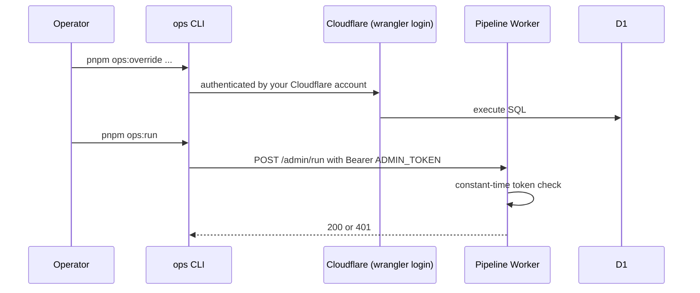

# Backend Architecture

## Service Architecture

### Function Organization

```text
apps/pipeline/src/
├── index.ts          # export default { scheduled, queue, fetch }
├── start-run.ts      # purge, create run, enqueue with staggered delay
├── process-store.ts  # one store: robots, fetch, classify, validate, extract, save
├── finalize-run.ts   # totals and alert
├── fetcher.ts        # polite fetch: UA, timeout, redirect cap, URL safety
├── robots.ts         # robots.txt allow check
├── repo.ts           # D1 reads and writes (data access layer)
└── alert.ts          # POST to ALERT_WEBHOOK_URL
```

**Built in Story 3.1 (2026-10-29):** `index.ts` (wiring only), `handlers.ts` (the three entry points), `start-run.ts` (no purge: retention is Story 4.6), `finalize-run.ts` (closes every open run), `repo.ts` (all pipeline SQL), `auth.ts` (`isAuthorized`), `admin-run.ts` (`POST /admin/run`), `config.ts` (`isPaused`), `log.ts`, `types.ts` and `env.d.ts`. `process-store.ts` is a **placeholder** that records `skipped_manual` for manual stores and `error` with `fetcher_not_built_yet` for the others, until Stories 3.2 to 3.5 build the fetch, classify, validate, extract and save steps. **Built in Story 3.2 (2026-10-30):** `fetcher.ts` (`fetchPage`: manual redirects, timeout, user-agent, https only), `robots.ts` (`checkRobots`), `probe.ts` (a CPU measurement stand-in, switched on only by `MEASURE_CPU=true`) and the real `process-store.ts` (robots, fetch, classify, record; it reads no page content and writes no sale records). `Deps` gained `fetch` (always passed as a wrapper, because the bare global fails with "Illegal invocation" in Workers) and an optional `createRewriter` (`HTMLRewriter` does not exist in Node). The pure rules are in `packages/core` (`url-safety.ts`, `classify.ts`, `robots.ts`). `POST /admin/run?store=<slug>` runs one store. `alert.ts` does not exist yet.

**Built in Story 3.3 (2026-10-30):** `validate.ts` in `packages/core` (`validateSalePage`, `recordEffect`, the verdict and signal types) and its samples in `packages/core/tests/fixtures/pages/` (a manifest `index.json` and 13 trimmed pages, each at most 16 KiB). In the pipeline `readLimited(response, maxBytes)` moved from `robots.ts` to `fetcher.ts` and returns `{ text, bytes, truncated }` (or null if the read fails); `MAX_PAGE_BYTES` is 3 MiB. `process-store.ts` reads the body of a plain `ok` page (not a `js_only`, blocked, not found, redirected or error answer, and not when `MEASURE_CPU` is on), judges it with `deps.validate ?? validateSalePage`, and logs one `page_validated` line; a failed read (`page_read_failed`) or a failing validator (`validation_failed`) is logged and never stops the store. Nothing about the verdict is saved yet: the `run_results` row is unchanged and `sale_records` is not written (Story 3.5).

### Function Template

```typescript
// apps/pipeline/src/index.ts
export default {
  async scheduled(controller: ScheduledController, env: Env, ctx: ExecutionContext) {
    // Two crons: start (03:00 UTC) and finalize (03:45 UTC)
    if (controller.cron === env.FINALIZE_CRON) return finalizeRun(env);
    return startRun(env, 'cron');
  },

  async queue(batch: MessageBatch<StoreJob>, env: Env) {
    for (const msg of batch.messages) {          // batch size is 1
      try {
        await processStore(env, msg.body);
        msg.ack();
      } catch (err) {
        log.error('process_store_failed', { retailerId: msg.body.retailerId, err });
        msg.retry();                              // max_retries = 1 in wrangler config
      }
    }
  },

  async fetch(req: Request, env: Env) {
    const url = new URL(req.url);
    if (req.method === 'POST' && url.pathname === '/admin/run') {
      if (!isAuthorized(req, env.ADMIN_TOKEN)) return new Response('Unauthorized', { status: 401 });
      await startRun(env, 'manual');
      return Response.json({ ok: true });
    }
    return new Response('Not found', { status: 404 });
  },
} satisfies ExportedHandler<Env, StoreJob>;
```

### Worker configuration (pipeline)

```jsonc
// apps/pipeline/wrangler.jsonc
{
  "name": "saleaway-pipeline",
  "main": "src/index.ts",
  "compatibility_date": "<pin at scaffold>",
  "compatibility_flags": ["nodejs_compat"],
  "triggers": { "crons": ["0 3 * * *", "45 3 * * *"] },
  "d1_databases": [{ "binding": "DB", "database_name": "saleaway", "database_id": "<created in Story 1.3>" }],
  "queues": {
    "producers": [{ "binding": "FETCH_QUEUE", "queue": "saleaway-fetch" }],
    "consumers": [{ "queue": "saleaway-fetch", "max_batch_size": 1, "max_retries": 1, "max_concurrency": 2 }]
  },
  "vars": { "FINALIZE_CRON": "45 3 * * *", "STAGGER_SECONDS": "15", "PIPELINE_ENABLED": "true" },
  "observability": { "enabled": true }
}
```

Secrets (`ADMIN_TOKEN`, `ALERT_WEBHOOK_URL`) are set with `wrangler secret put` and are never in the repository (NFR10). The `FETCH_QUEUE` queue is created once with `wrangler queues create saleaway-fetch`.

**Decisions made in Story 3.1:** run totals count `ok`, `js_only` and `skipped_manual` as OK and every other result, including an unknown one, as failed. `controller.cron` is compared with `FINALIZE_CRON` to choose between closing and starting a run. The close step closes every open run (at most 10 per invocation) and a run with missing results is closed with a gap (`stores_ok + stores_failed` below `stores_total`). A failing queue message is retried once and then recorded as an `error` result, so every store of a run ends with a result; a message that cannot be read is acknowledged and logged as `bad_job`; a store that no longer exists is logged and nothing is written, because `run_results.retailer_id` is a foreign key. A paused pipeline starts no run and closes none, while messages already queued are still processed. `POST /admin/run` answers 401 for a bad or missing token, 409 when paused (checked after the token) and 500 if the run cannot start, with the error JSON from the error handling strategy; any other request is a plain 404. A manual run starts a new run; two runs in one day produce two sets of results.

## Database Architecture

### Schema Design

See "Database Schema" above.

### Data Access Layer

```typescript
// apps/pipeline/src/repo.ts
export async function saveSaleResult(db: D1Database, r: SaleResultInput): Promise<void> {
  await db.batch([
    db.prepare(`
      INSERT INTO sale_records (retailer_id, state, validation, discount_percent, last_result,
                                first_seen_at, last_checked_at, last_validated_at)
      VALUES (?1, ?2, ?3, ?4, ?5, ?6, ?6, ?7)
      ON CONFLICT(retailer_id) DO UPDATE SET
        state = excluded.state, validation = excluded.validation,
        discount_percent = excluded.discount_percent, last_result = excluded.last_result,
        last_checked_at = excluded.last_checked_at,
        last_validated_at = COALESCE(excluded.last_validated_at, sale_records.last_validated_at)
    `).bind(r.retailerId, r.state, r.validation, r.discountPercent, r.result, r.now, r.validatedAt),
    db.prepare(`INSERT INTO run_results (run_id, retailer_id, result, http_status,
                                         discount_percent, duration_ms, error)
                VALUES (?1,?2,?3,?4,?5,?6,?7)`)
      .bind(r.runId, r.retailerId, r.result, r.httpStatus, r.discountPercent, r.durationMs, r.error),
  ]);
}
```

## Authentication and Authorization

### Auth Flow



Visitors never authenticate. This closes the PRD checklist gap on operator tool security with **no public admin page at all**: the override command and the health report are CLI commands that use your Cloudflare login, and the only public operator endpoint (`/admin/run`) needs a secret token.

### Middleware/Guards

```typescript
export function isAuthorized(req: Request, token: string | undefined): boolean {
  const header = req.headers.get('Authorization') ?? '';
  const supplied = header.startsWith('Bearer ') ? header.slice(7) : '';
  if (!token || supplied.length !== token.length) return false;
  let diff = 0;                                  // constant-time comparison
  for (let i = 0; i < token.length; i++) diff |= token.charCodeAt(i) ^ supplied.charCodeAt(i);
  return diff === 0;
}
```
