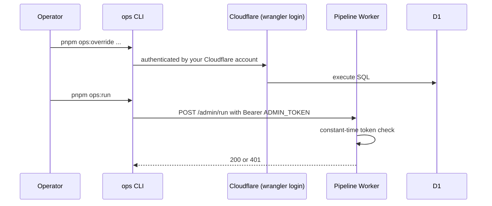

# Backend Architecture

## Service Architecture

### Function Organization

```text
apps/pipeline/src/
├── index.ts          # export default { scheduled, queue, fetch }
├── start-run.ts      # purge, create run, enqueue with staggered delay
├── process-store.ts  # one store: robots, fetch, classify, validate, extract, save
├── finalize-run.ts   # totals and alert
├── fetcher.ts        # polite fetch: UA, timeout, redirect cap, URL safety
├── robots.ts         # robots.txt allow check
├── repo.ts           # D1 reads and writes (data access layer)
└── alert.ts          # POST to ALERT_WEBHOOK_URL
```

**Built in Story 3.1 (2026-10-29):** `index.ts` (wiring only), `handlers.ts` (the three entry points), `start-run.ts` (no purge: retention is Story 4.6), `finalize-run.ts` (closes every open run), `repo.ts` (all pipeline SQL), `auth.ts` (`isAuthorized`), `admin-run.ts` (`POST /admin/run`), `config.ts` (`isPaused`), `log.ts`, `types.ts` and `env.d.ts`. `process-store.ts` is a **placeholder** that records `skipped_manual` for manual stores and `error` with `fetcher_not_built_yet` for the others, until Stories 3.2 to 3.5 build the fetch, classify, validate, extract and save steps. **Built in Story 3.2 (2026-10-30):** `fetcher.ts` (`fetchPage`: manual redirects, timeout, user-agent, https only), `robots.ts` (`checkRobots`), `probe.ts` (a CPU measurement stand-in, switched on only by `MEASURE_CPU=true`) and the real `process-store.ts` (robots, fetch, classify, record; it reads no page content and writes no sale records). `Deps` gained `fetch` (always passed as a wrapper, because the bare global fails with "Illegal invocation" in Workers) and an optional `createRewriter` (`HTMLRewriter` does not exist in Node). The pure rules are in `packages/core` (`url-safety.ts`, `classify.ts`, `robots.ts`). `POST /admin/run?store=<slug>` runs one store. `alert.ts` does not exist yet.

**Built in Story 3.3 (2026-10-30):** `validate.ts` in `packages/core` (`validateSalePage`, `recordEffect`, the verdict and signal types) and its samples in `packages/core/tests/fixtures/pages/` (a manifest `index.json` and 13 trimmed pages, each at most 16 KiB). In the pipeline `readLimited(response, maxBytes)` moved from `robots.ts` to `fetcher.ts` and returns `{ text, bytes, truncated }` (or null if the read fails); `MAX_PAGE_BYTES` is 3 MiB. `process-store.ts` reads the body of a plain `ok` page (not a `js_only`, blocked, not found, redirected or error answer, and not when `MEASURE_CPU` is on), judges it with `deps.validate ?? validateSalePage`, and logs one `page_validated` line; a failed read (`page_read_failed`) or a failing validator (`validation_failed`) is logged and never stops the store. Nothing about the verdict is saved yet: the `run_results` row is unchanged and `sale_records` is not written (Story 3.5).

**Built in Story 3.5 (2026-10-30):** `sale-record.ts` in `packages/core` (`nextSaleRecord`, the types `SaleRecordFields` and `FetchEvent`); in `repo.ts`, `getSaleRecord` (one `SELECT`, an old row with no `last_result` reads as `error`) and `saveStoreResult` (the result row and the sale record in one `db.batch`); in `process-store.ts` the result is now saved with its record. `recordStoreError` still writes only a result row. Nothing in the web app changed: the home query already reads `sale_records` (Story 2.3), but the live web app does not use the new rules until it is deployed.

**Built in Story 3.4 (2026-10-30):** the extractors in `packages/core/src/extract/` (`extractShopifyDiscount`, `extractHtmlDiscount`, `extractStructuredDiscount` and the dispatcher `extractDiscount`, with the range `MIN_DISCOUNT` 5 and `MAX_DISCOUNT` 90) and `page-scan.ts` (the linear scanners that the validator and the extractors share: `removeBlocks`, `textNodes`, the amount, badge and old-price patterns). In the pipeline: `shopify.ts` (`productsJsonUrl`, `isShopifyCollection`, `fetchShopifyFeed`); `checkRobots` now returns `{ decision, text }` so the feed's path is checked against the robots.txt already read; `process-store.ts` reads the discount of a `valid` page (`readPercent`), requests the feed of a `shopify_json` store only when its sale address is exactly `/collections/<handle>` (once, never retried, a 429 is `blocked`), logs one `discount_extracted` line (`slug`, `method`, `percent`, `feed`, `feedBytes`: no text), and saves the percentage in the record and the result row; `Deps` has an optional `extract` for tests. `under-armour-sa` was set to the `html` method because it has no feed.

**Built in Story 3.10 (2026-10-31):** fewer false `ended` verdicts. In `packages/core`: `AMOUNT` and `PRICE` in `page-scan.ts` accept `ZAR` as well as `R`; a new `SAVE_NODE` pattern; in `validate.ts` the `saveLabels` signal (a seventh count, counted as a discount signal), the narrower empty-listing rule, the "calls itself a sale" guard (`SALE_WORDS`, whole words, tested on the title, the first heading and the address path) and the new reason `discounts_not_readable`. Four real pages (Gelmar, Spar, Evetech, Mr Price) and one plain category page are page samples; the older `no-discounts-listing.html` sample is now `unverifiable` because its title and address say "specials". In `apps/pipeline`, `listUnfinishedRuns` returns the newest unfinished runs first (the cap of 10 stays: D1 allows 50 queries per invocation and closing a run takes 2). The extractors read `ZAR` prices too (a Gelmar-style pair gives its percentage).

**Built in Story 3.6 (2026-10-31):** the coverage report. `scripts/ops/src/coverage-plan.ts` is pure (the buckets and the Markdown) and `coverage.ts` is the command: `pnpm ops:coverage --local | --remote [--run <id>] [--out docs/data/<file>.md]`. It runs three read-only queries (the run with its first and last result times, every store with its result for that run and its sale record, and the active overrides), prints the report, or writes it when `--out` is given (inside `docs/data/`, a `.md` file, resolved from the repository root). It writes nothing to the database. `run_results` keeps each night's result, but `sale_records` is overwritten by every run, so the report states the date its records are from and warns when they are newer than the run it describes. Reports of the first runs are `docs/data/first-run-coverage.md` (with the free-tier check) and, when made, `docs/data/second-run-coverage.md`. `loot` was changed to `structured_data` in the live database by a one-row update (the seed never changes an existing store's method).

### Function Template

```typescript
// apps/pipeline/src/index.ts
export default {
  async scheduled(controller: ScheduledController, env: Env, ctx: ExecutionContext) {
    // Two crons: start (03:00 UTC) and finalize (03:45 UTC)
    if (controller.cron === env.FINALIZE_CRON) return finalizeRun(env);
    return startRun(env, 'cron');
  },

  async queue(batch: MessageBatch<StoreJob>, env: Env) {
    for (const msg of batch.messages) {          // batch size is 1
      try {
        await processStore(env, msg.body);
        msg.ack();
      } catch (err) {
        log.error('process_store_failed', { retailerId: msg.body.retailerId, err });
        msg.retry();                              // max_retries = 1 in wrangler config
      }
    }
  },

  async fetch(req: Request, env: Env) {
    const url = new URL(req.url);
    if (req.method === 'POST' && url.pathname === '/admin/run') {
      if (!isAuthorized(req, env.ADMIN_TOKEN)) return new Response('Unauthorized', { status: 401 });
      await startRun(env, 'manual');
      return Response.json({ ok: true });
    }
    return new Response('Not found', { status: 404 });
  },
} satisfies ExportedHandler<Env, StoreJob>;
```

### Worker configuration (pipeline)

```jsonc
// apps/pipeline/wrangler.jsonc
{
  "name": "saleaway-pipeline",
  "main": "src/index.ts",
  "compatibility_date": "<pin at scaffold>",
  "compatibility_flags": ["nodejs_compat"],
  "triggers": { "crons": ["0 3 * * *", "45 3 * * *"] },
  "d1_databases": [{ "binding": "DB", "database_name": "saleaway", "database_id": "<created in Story 1.3>" }],
  "queues": {
    "producers": [{ "binding": "FETCH_QUEUE", "queue": "saleaway-fetch" }],
    "consumers": [{ "queue": "saleaway-fetch", "max_batch_size": 1, "max_retries": 1, "max_concurrency": 2 }]
  },
  "vars": { "FINALIZE_CRON": "45 3 * * *", "STAGGER_SECONDS": "15", "PIPELINE_ENABLED": "true" },
  "observability": { "enabled": true }
}
```

Secrets (`ADMIN_TOKEN`, `ALERT_WEBHOOK_URL`) are set with `wrangler secret put` and are never in the repository (NFR10). The `FETCH_QUEUE` queue is created once with `wrangler queues create saleaway-fetch`.

**Decisions made in Story 3.1:** run totals count `ok`, `js_only` and `skipped_manual` as OK and every other result, including an unknown one, as failed. `controller.cron` is compared with `FINALIZE_CRON` to choose between closing and starting a run. The close step closes every open run (at most 10 per invocation) and a run with missing results is closed with a gap (`stores_ok + stores_failed` below `stores_total`). A failing queue message is retried once and then recorded as an `error` result, so every store of a run ends with a result; a message that cannot be read is acknowledged and logged as `bad_job`; a store that no longer exists is logged and nothing is written, because `run_results.retailer_id` is a foreign key. A paused pipeline starts no run and closes none, while messages already queued are still processed. `POST /admin/run` answers 401 for a bad or missing token, 409 when paused (checked after the token) and 500 if the run cannot start, with the error JSON from the error handling strategy; any other request is a plain 404. A manual run starts a new run; two runs in one day produce two sets of results.

## Database Architecture

### Schema Design

See "Database Schema" above.

### Data Access Layer

```typescript
// apps/pipeline/src/repo.ts
export async function saveSaleResult(db: D1Database, r: SaleResultInput): Promise<void> {
  await db.batch([
    db.prepare(`
      INSERT INTO sale_records (retailer_id, state, validation, discount_percent, last_result,
                                first_seen_at, last_checked_at, last_validated_at)
      VALUES (?1, ?2, ?3, ?4, ?5, ?6, ?6, ?7)
      ON CONFLICT(retailer_id) DO UPDATE SET
        state = excluded.state, validation = excluded.validation,
        discount_percent = excluded.discount_percent, last_result = excluded.last_result,
        last_checked_at = excluded.last_checked_at,
        last_validated_at = COALESCE(excluded.last_validated_at, sale_records.last_validated_at)
    `).bind(r.retailerId, r.state, r.validation, r.discountPercent, r.result, r.now, r.validatedAt),
    db.prepare(`INSERT INTO run_results (run_id, retailer_id, result, http_status,
                                         discount_percent, duration_ms, error)
                VALUES (?1,?2,?3,?4,?5,?6,?7)`)
      .bind(r.runId, r.retailerId, r.result, r.httpStatus, r.discountPercent, r.durationMs, r.error),
  ]);
}
```

## Authentication and Authorization

### Auth Flow



Visitors never authenticate. This closes the PRD checklist gap on operator tool security with **no public admin page at all**: the override command and the health report are CLI commands that use your Cloudflare login, and the only public operator endpoint (`/admin/run`) needs a secret token.

### Middleware/Guards

```typescript
export function isAuthorized(req: Request, token: string | undefined): boolean {
  const header = req.headers.get('Authorization') ?? '';
  const supplied = header.startsWith('Bearer ') ? header.slice(7) : '';
  if (!token || supplied.length !== token.length) return false;
  let diff = 0;                                  // constant-time comparison
  for (let i = 0; i < token.length; i++) diff |= token.charCodeAt(i) ^ supplied.charCodeAt(i);
  return diff === 0;
}
```
