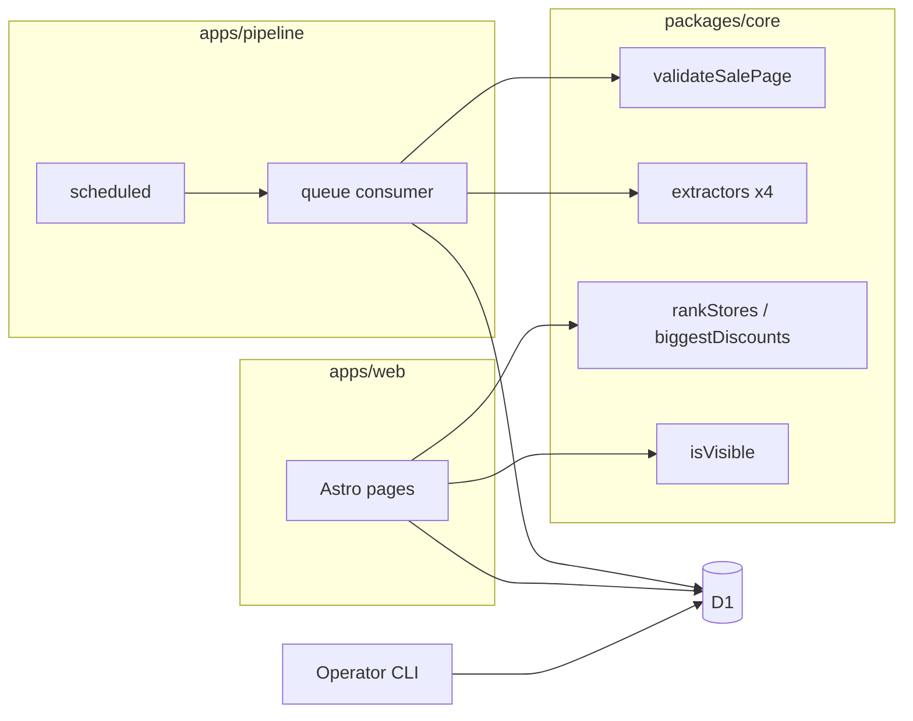

# Components

## Web Worker (`apps/web`)

**Responsibility:** render and serve the public site.

**Key Interfaces:**
- Pages: home, About, Privacy, Contact, plus `/health`.
- `getHomeViewModel(db)` returns category cards, the "Biggest discounts today" card and the status strip data.
- `POST /api/click`.

**Dependencies:** D1 (read-mostly), `packages/core` for ranking and visibility rules.

**Technology Stack:** Astro SSR on Workers, CSS tokens from `docs/front-end-spec.md`, Cache API.

## Pipeline Worker (`apps/pipeline`)

**Responsibility:** the daily discovery job in three entry points: `scheduled` (start a run and enqueue), `queue` (process one store), and a second `scheduled` (finalize the run and alert).

**Key Interfaces:**
- `scheduled(controller)` selects the entry by cron expression.
- `queue(batch)` handles one store per message.
- `fetch(request)` for `POST /admin/run` only.

**Dependencies:** D1, Queues, `packages/core`.

**Technology Stack:** TypeScript on Workers, `HTMLRewriter` or targeted parsing for HTML, `JSON.parse` for Shopify JSON.

## Core package (`packages/core`)

**Responsibility:** pure logic with no I/O: `classifyResponse`, `validateSalePage`, one extractor per method, `rankStores`, `isVisible`, `biggestDiscounts`, URL safety checks, the structured logger and shared types.

**Key Interfaces:** pure functions, each taking plain data and returning plain data.

**Dependencies:** none.

**Technology Stack:** TypeScript, Vitest.

## Operator CLI (`scripts/ops`)

**Responsibility:** the commands in Stories 1.3, 4.1, 4.2 and 4.3.

**Key Interfaces:** `pnpm ops:seed`, `pnpm ops:override`, `pnpm ops:health`, `pnpm ops:check-urls`, `pnpm ops:run` (calls `/admin/run`).

**Dependencies:** Wrangler (`wrangler d1 execute --remote`), authenticated by your Cloudflare login.

**Technology Stack:** TypeScript scripts run with `tsx`.

## Component Diagrams

