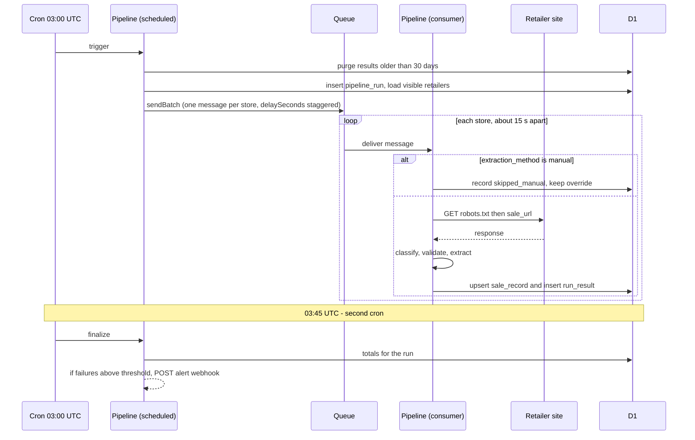
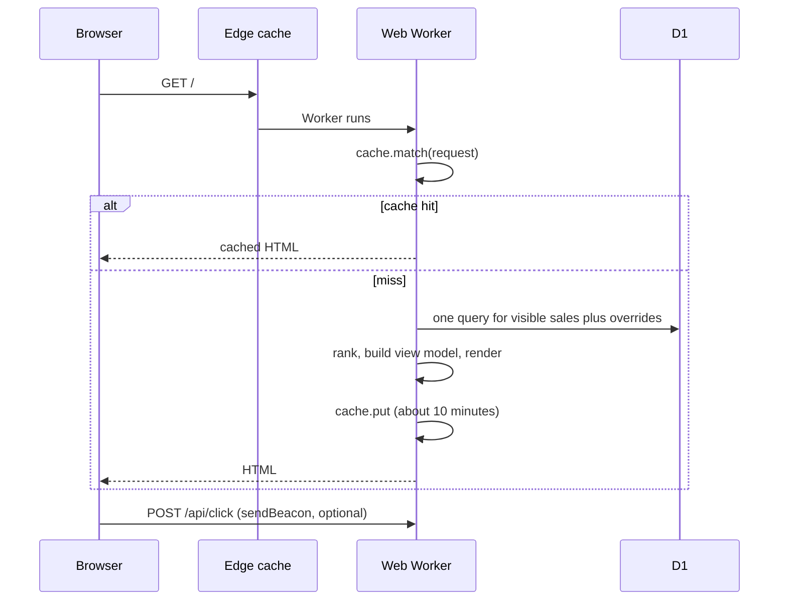

# Core Workflows

## Daily pipeline

## State rules per fetch result

| Result | Effect on sale record |
|---|---|
| `ok` and validated with discounted products | `active`, `content_verified`, percentage set (or null for "On sale"), `last_validated_at` updated |
| `ok` but no discounted products (verdict `ended`) | `ended`, `ended_at` set (FR10) |
| `ok` but the page is a bot challenge or a login page (verdict `blocked`, Story 3.3) | last good record is kept, as for `blocked`: only `last_checked_at` and `last_result` change |
| `ok` but the page cannot be judged, for example it is a JavaScript application (verdict `unverifiable`, Story 3.3) | `active`, `url_verified`, shown as "On sale", `last_validated_at` updated |
| `js_only` (page loads but products render with JavaScript) | `active`, `url_verified`, shown as "On sale", `last_validated_at` updated (the URL answered), so the store stays fresh |
| `blocked`, `error` | last good record is kept, only `last_checked_at` and `last_result` change |
| `not_found`, `redirected_away` | `ended` |

A record is hidden when it is `ended`, when its freshness time is older than 72 hours, or when an active override hides it. The **freshness time** is the latest of `last_validated_at`, the time an active override was created, and, only for a store that has never been validated, the time the retailer row was created. Without that last part the site would be empty until the first pipeline run. These rules live in `resolveStore` (and `isVisible`, which returns only its `visible` field) in `packages/core` and were built in Story 2.3, together with override precedence (an active override's percentage and sale URL replace the extracted ones).

**The rules as built (Story 2.3, 2026-10-30).** The store is judged in this order, and the first rule that hides it gives the reason (`flag`, `no_sale_url`, `override_hide`, `ended`, `stale`): (1) an override is *active* when it exists and its `expires_at` is empty or later than now (equal to now is expired; an `expires_at` that is not a valid date is treated as not expired); an expired override is ignored everywhere; (2) `is_visible` is 0: hidden; (3) the effective sale URL (the active override's, else the retailer's) does not start with `https://`: hidden; (4) an active override with `hide`: hidden; (5) the record is `ended`: hidden, **unless an active override sets a percentage** (the operator says it is on sale); (6) the freshness time is more than 72 hours old: hidden (exactly 72 hours is still shown). The freshness time is the later of (a) the record's `last_validated_at`, or the retailer's `created_at` when there is none, and (b) the creation time of any active override. A date that does not parse counts as missing, and a store with no usable time is hidden. The percentage shown is the active override's, else the record's, else none ("On sale"). The functions take `now` as a parameter and read nothing else. `is_visible` is the only way to show a store that the operator flag hides.

**Run totals (Story 3.1):** when a run is closed, `stores_ok` counts the results `ok`, `js_only` and `skipped_manual`, and `stores_failed` counts every other result (`blocked`, `not_found`, `redirected_away`, `error`, or any value that is not a known class). The rule is `summariseRun` in `packages/core`.

**Fetch results (Story 3.2):** the status mapping is `401`, `403`, `429` and `503` blocked; `404` and `410` not found; any other status outside 2xx an error; a 2xx on another site or the home page `redirected_away`; a 2xx on a store whose spreadsheet status is `verified_js_shell` `js_only`; any other 2xx `ok`. A `robots.txt` refusal is recorded as `blocked` (text `robots_disallow`) and an unreachable `robots.txt` as an error (`robots_unreachable`); in both cases the page is not requested. The text saved in `run_results.error` is one of `robots_disallow`, `robots_unreachable`, `unsafe_url`, `timeout`, `network`, `too_many_redirects`, `unsafe_redirect`, `bad_redirect`, `http_<status>` or `redirected_to_<host>`.

**Validation (Story 3.3, 2026-10-30).** A page classified `ok` is read (at most 3 MiB) and judged by `validateSalePage` in `packages/core`, which returns a verdict, a reason and counts, never page text. The four verdicts: `valid` (discounted products: at least two discount signals, that is percentage-off labels, was prices or structured price fields, and at least two prices), `ended` (the page is up but there is no sale: redirected away, an error page, an empty listing, or priced products with no discount signal), `blocked` (a bot challenge or a login page: the same as a blocked fetch) and `unverifiable` (the page cannot be judged: a JavaScript application whose products are not in the HTML, a page cut at the size limit, or nothing recognisable). The rules apply in this order and the first match decides: redirected away, challenge (a marker in the title, or in the first 4 KiB of text on a page that lists fewer than three prices), login, error page, discounts found, JavaScript shell, empty listing, no discounts, unreadable; the last two ended verdicts are never given to a truncated page. A page is called "not a sale" only on positive evidence. `recordEffect(verdict)` says what the sale record becomes (applied by Story 3.5): `valid` is `active` and `content_verified`; `ended` is `ended`; `blocked` keeps the last good record, as for a blocked fetch; `unverifiable` is `active` and `url_verified`, shown as "On sale". Until Story 3.5 the verdict is only logged (`page_validated`: the slug, verdict, reason, bytes, truncated and six counts).

**Sale records as built (Story 3.5, 2026-10-30).** `nextSaleRecord(previous, event)` in `packages/core` decides the whole new record after one fetch; `saveStoreResult` in `repo.ts` saves it together with the `run_results` row in one D1 batch (one transaction: both are saved or neither), and `processStore` reads the previous record first. A manual store (`skipped_manual`) writes no record. **Active** (a `valid` or `unverifiable` verdict, or a `js_only` answer): `validation` is `content_verified` or `url_verified`, `last_validated_at` is now, `ended_at` is cleared, and `first_seen_at` is kept unless the record is new or the sale had ended (a sale that comes back is a new sale, so it starts again). **Ended** (a verdict `ended`, `not_found` or `redirected_away`): `validation` is `none`, the percentage is cleared, `ended_at` is set once and kept while the record stays ended, and `last_validated_at` is left alone because a failed page is not a validation. **Kept** (`blocked`, `error`, a `blocked` verdict, or an `ok` page that was not judged): only `last_result` and `last_checked_at` change, so Story 2.3 hides the store after 72 hours without a good check; a store with no record gets an `unknown` one, which the site judges from `retailers.created_at`. `last_result` and `last_checked_at` are set every night. The percentage is written only if it is a whole number from 5 to 90 (the table refuses anything else); until Story 3.4 it is always null. The record holds no URL and no page text.

## Page view

## Operator override

`pnpm ops:override --slug crocs-sa --percent 50 --expires 2026-11-30` writes one row to `overrides` through `wrangler d1 execute --remote`. The site reflects it when the cached page expires (about 10 minutes at most).
