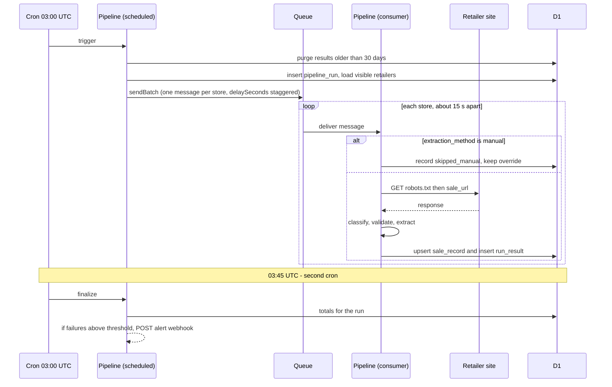
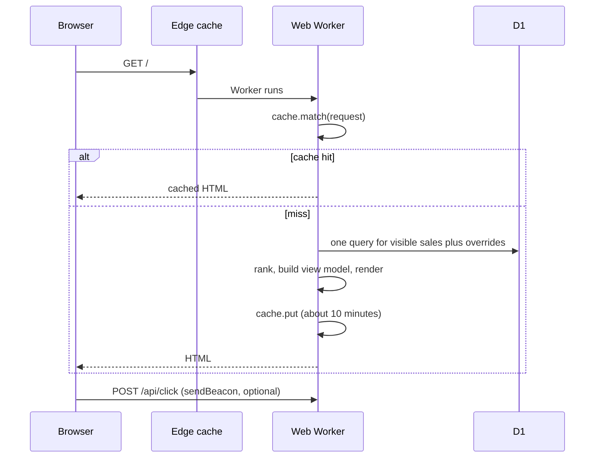

# Core Workflows

## Daily pipeline

## State rules per fetch result

| Result | Effect on sale record |
|---|---|
| `ok` and validated with discounted products | `active`, `content_verified`, percentage set (or null for "On sale"), `last_validated_at` updated |
| `ok` but no discounted products (verdict `ended`) | `ended`, `ended_at` set (FR10) |
| `ok` but the page is a bot challenge or a login page (verdict `blocked`, Story 3.3) | last good record is kept, as for `blocked`: only `last_checked_at` and `last_result` change |
| `ok` but the page cannot be judged, for example it is a JavaScript application (verdict `unverifiable`, Story 3.3) | `active`, `url_verified`, shown as "On sale", `last_validated_at` updated |
| `js_only` (page loads but products render with JavaScript) | `active`, `url_verified`, shown as "On sale", `last_validated_at` updated (the URL answered), so the store stays fresh |
| `blocked`, `error` | last good record is kept, only `last_checked_at` and `last_result` change |
| `not_found`, `redirected_away` | `ended` |

A record is hidden when it is `ended`, when its freshness time is older than 72 hours, or when an active override hides it. The **freshness time** is `last_validated_at` and, only for a store that has never been validated, the time the retailer row was created (without that the site would be empty until the first pipeline run); **a store with an active override is not judged stale at all while the override is active** (Story 4.1). These rules live in `resolveStore` (and `isVisible`, which returns only its `visible` field) in `packages/core` and were built in Story 2.3, together with override precedence (an active override's percentage and sale URL replace the extracted ones).

**The rules as built (Story 2.3, 2026-10-30).** The store is judged in this order, and the first rule that hides it gives the reason (`flag`, `no_sale_url`, `override_hide`, `ended`, `stale`): (1) an override is *active* when it exists and its `expires_at` is empty or later than now (equal to now is expired; an `expires_at` that is not a valid date is treated as not expired); an expired override is ignored everywhere; (2) `is_visible` is 0: hidden; (3) the effective sale URL (the active override's, else the retailer's) does not start with `https://`: hidden; (4) an active override with `hide`: hidden; (5) the record is `ended`: hidden, **unless an active override sets a percentage** (the operator says it is on sale); (6) the freshness time is more than 72 hours old: hidden (exactly 72 hours is still shown). The freshness time is the record's `last_validated_at`, or the retailer's `created_at` when there is none; **a store with an active override is not judged stale while the override is active** (its freshness time is now; Story 4.1: the operator who sets an override vouches for the store, and the override's expiry date ends that). A date that does not parse counts as missing, and a store with no usable time is hidden. The percentage shown is the active override's, else the record's, else none ("On sale"). The functions take `now` as a parameter and read nothing else. `is_visible` is the only way to show a store that the operator flag hides.

**Run totals (Story 3.1):** when a run is closed, `stores_ok` counts the results `ok`, `js_only` and `skipped_manual`, and `stores_failed` counts every other result (`blocked`, `not_found`, `redirected_away`, `error`, or any value that is not a known class). The rule is `summariseRun` in `packages/core`.

**Fetch results (Story 3.2):** the status mapping is `401`, `403`, `429` and `503` blocked; `404` and `410` not found; any other status outside 2xx an error; a 2xx on another site or the home page `redirected_away`; a 2xx on a store whose spreadsheet status is `verified_js_shell` `js_only`; any other 2xx `ok`. A `robots.txt` refusal is recorded as `blocked` (text `robots_disallow`) and an unreachable `robots.txt` as an error (`robots_unreachable`); in both cases the page is not requested. The text saved in `run_results.error` is one of `robots_disallow`, `robots_unreachable`, `unsafe_url`, `timeout`, `network`, `too_many_redirects`, `unsafe_redirect`, `bad_redirect`, `http_<status>` or `redirected_to_<host>`.

**Validation (Story 3.3, 2026-10-30).** A page classified `ok` is read (at most 3 MiB) and judged by `validateSalePage` in `packages/core`, which returns a verdict, a reason and counts, never page text. The four verdicts: `valid` (discounted products: at least two discount signals, that is percentage-off labels, was prices or structured price fields, and at least two prices), `ended` (the page is up but there is no sale: redirected away, an error page, an empty listing, or priced products with no discount signal), `blocked` (a bot challenge or a login page: the same as a blocked fetch) and `unverifiable` (the page cannot be judged: a JavaScript application whose products are not in the HTML, a page cut at the size limit, or nothing recognisable). The rules apply in this order and the first match decides: redirected away, challenge (a marker in the title, or in the first 4 KiB of text on a page that lists fewer than three prices), login, error page, discounts found, JavaScript shell, empty listing, no discounts, unreadable; the last two ended verdicts are never given to a truncated page. A page is called "not a sale" only on positive evidence. `recordEffect(verdict)` says what the sale record becomes (applied by Story 3.5): `valid` is `active` and `content_verified`; `ended` is `ended`; `blocked` keeps the last good record, as for a blocked fetch; `unverifiable` is `active` and `url_verified`, shown as "On sale". Until Story 3.5 the verdict is only logged (`page_validated`: the slug, verdict, reason, bytes, truncated and six counts).

**Sale records as built (Story 3.5, 2026-10-30).** `nextSaleRecord(previous, event)` in `packages/core` decides the whole new record after one fetch; `saveStoreResult` in `repo.ts` saves it together with the `run_results` row in one D1 batch (one transaction: both are saved or neither), and `processStore` reads the previous record first. A manual store (`skipped_manual`) writes no record. **Active** (a `valid` or `unverifiable` verdict, or a `js_only` answer): `validation` is `content_verified` or `url_verified`, `last_validated_at` is now, `ended_at` is cleared, and `first_seen_at` is kept unless the record is new or the sale had ended (a sale that comes back is a new sale, so it starts again). **Ended** (a verdict `ended`, `not_found` or `redirected_away`): `validation` is `none`, the percentage is cleared, `ended_at` is set once and kept while the record stays ended, and `last_validated_at` is left alone because a failed page is not a validation. **Kept** (`blocked`, `error`, a `blocked` verdict, or an `ok` page that was not judged): only `last_result` and `last_checked_at` change, so Story 2.3 hides the store after 72 hours without a good check; a store with no record gets an `unknown` one, which the site judges from `retailers.created_at`. `last_result` and `last_checked_at` are set every night. The percentage is written only if it is a whole number from 5 to 90 (the table refuses anything else); until Story 3.4 it is always null. The record holds no URL and no page text.

**How the discount is read (Story 3.4, 2026-10-30).** Only a page judged `valid` has a percentage; an `unverifiable`, `ended` or `blocked` page, a `js_only` store and a `manual` store have none and are shown as "On sale". The extractors in `packages/core/src/extract/` each return a whole number from **5 to 90** (the range of `sale_records.discount_percent`; anything else is ignored) or null, and never throw. By `extraction_method`: **`html`** reads the page without its scripts, styles, `<nav>`, `<header>` and `<footer>`: first the **was/now price pairs** (an old-price marker such as `old-price`, `standard-price`, `line-through`, `<s>`, `<del>`, the text "was R...", or an aria-label "Standard Price ZAR a, Sale Price ZAR b", with the nearest smaller amount as the now price), and only if there is no in-range pair the **percentage labels** (a text element that is only "30% off", "-25%" or "save 25%"); a pair beats a label because a label can come from a banner. **`structured_data`** reads price fields in the page's script data (a list price followed by a price, or an `AggregateOffer` high and low price) and falls back to the markup. **`shopify_json`** reads the product feed of the collection (the largest gap from `compare_at_price` to `price`) and falls back to the page. The percentage is `round((was - now) / was * 100)`. It goes into the sale record and into the `run_results` row.

## Page view

## Operator override

`pnpm ops:override --local | --remote` is the operator's override command (Story 4.1). It checks everything before it writes, writes through `wrangler d1 execute`, then reads the database back and exits with an error if it does not hold what was meant. The modes: **change** (`--slug` with `--percent <1-99 or none>`, `--hide` or `--unhide`, `--url <https address or none>`, `--expires <YYYY-MM-DD or none>`, `--note <text>`) creates the store's override, or changes only the fields named (a field that is not named keeps its value) and sets `created_at` to now; **`--clear`** deletes it; **`--list`** shows every override and whether it is active or expired; **`--export`** writes `docs/data/overrides.json`; **`--import`** restores the overrides from that file with their saved times. A percentage is a whole number from 1 to 99 (the table's CHECK; wider than the 5 to 90 of an extracted one), an address must pass the same safety rule as the pipeline's fetcher (https, no IP address, no port) and be stored exactly as typed (it starts with lower-case `https://` and has no space or other blank in it, because the site checks the start of the stored text), an expiry date is the end of that day in UTC and may not be in the past, and a note is at most 200 characters. The validation lives in `packages/core` (`parseOverrideChange`, `parseOverridesFile`), so a later admin page can use it. **`--bring-back`** (with `--slug`) shows a store that Story 3.9 hid, with manual values: it writes the override first (the hide flag cleared) and then sets the store to the `manual` method and visible, so the pipeline never fetches it again; it refuses a store with no https sale address; on `--remote` only it also takes the store off `docs/data/hidden-stores.json`. An override with a percentage also beats an `ended` record on the site, so it is the quick fix for a store that was wrongly ended. The site reflects a change as soon as the page is read (there is no page cache yet; once Story 2.4 adds one, within about 10 minutes). The pipeline never writes or deletes overrides.
