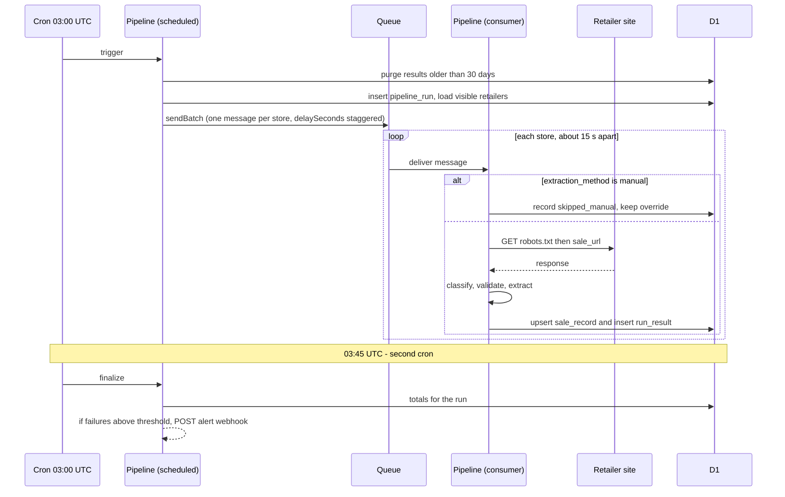
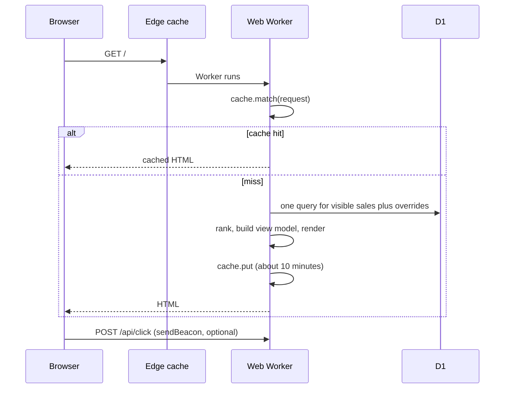

# Core Workflows

## Daily pipeline

## State rules per fetch result

| Result | Effect on sale record |
|---|---|
| `ok` and validated with discounted products | `active`, `content_verified`, percentage set (or null for "On sale"), `last_validated_at` updated |
| `ok` but no discounted products | `ended`, `ended_at` set (FR10) |
| `js_only` (page loads but products render with JavaScript) | `active`, `url_verified`, shown as "On sale" |
| `blocked`, `error` | last good record is kept, only `last_checked_at` and `last_result` change |
| `not_found`, `redirected_away` | `ended` |

A record is hidden when it is `ended`, when its freshness time is older than 72 hours, or when an active override hides it. The **freshness time** is the latest of `last_validated_at`, the time an active override that sets a percentage was created, and, only for a store that has never been validated, the time the retailer row was created. Without that last part the site would be empty until the first pipeline run. These rules live in `isVisible` in `packages/core` and are built in Story 2.3, together with override precedence (an active override's percentage and sale URL replace the extracted ones).

**Run totals (Story 3.1):** when a run is closed, `stores_ok` counts the results `ok`, `js_only` and `skipped_manual`, and `stores_failed` counts every other result (`blocked`, `not_found`, `redirected_away`, `error`, or any value that is not a known class). The rule is `summariseRun` in `packages/core`.

**Fetch results (Story 3.2):** the status mapping is `401`, `403`, `429` and `503` blocked; `404` and `410` not found; any other status outside 2xx an error; a 2xx on another site or the home page `redirected_away`; a 2xx on a store whose spreadsheet status is `verified_js_shell` `js_only`; any other 2xx `ok`. A `robots.txt` refusal is recorded as `blocked` (text `robots_disallow`) and an unreachable `robots.txt` as an error (`robots_unreachable`); in both cases the page is not requested. The text saved in `run_results.error` is one of `robots_disallow`, `robots_unreachable`, `unsafe_url`, `timeout`, `network`, `too_many_redirects`, `unsafe_redirect`, `bad_redirect`, `http_<status>` or `redirected_to_<host>`.

## Page view

## Operator override

`pnpm ops:override --slug crocs-sa --percent 50 --expires 2026-11-30` writes one row to `overrides` through `wrangler d1 execute --remote`. The site reflects it when the cached page expires (about 10 minutes at most).
