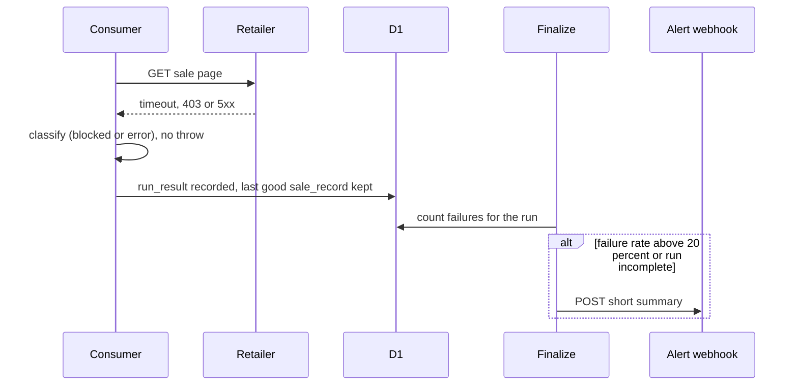

# Error Handling Strategy

## Error Flow



## Error Response Format

```typescript
interface ApiError {
  error: { code: string; message: string; requestId: string; timestamp: string };
}
```

Used by `/api/click` and `/admin/run` only. Page routes return HTML.

## Frontend Error Handling

If D1 is unavailable and a cached copy exists, serve the cached page. If there is no cached copy, render the friendly "Sales are loading, check back soon" card with status 503 (Story 1.4, AC5).

```typescript
try {
  vm = await loadHomeViewModel(db);
} catch (err) {
  log.error('home_failed', { err });
  return renderEmptyState(503);
}
```

## Backend Error Handling

```typescript
export function classifyFetch(res: Response | null, err: unknown): FetchClass {
  if (err) return 'error';
  if (!res) return 'error';
  if (res.status === 403 || res.status === 429 || res.status === 503) return 'blocked';
  if (res.status === 404 || res.status === 410) return 'not_found';
  if (res.status >= 500) return 'error';
  return 'ok';   // further checks (redirected away, js_only) happen after reading the body
}
```
