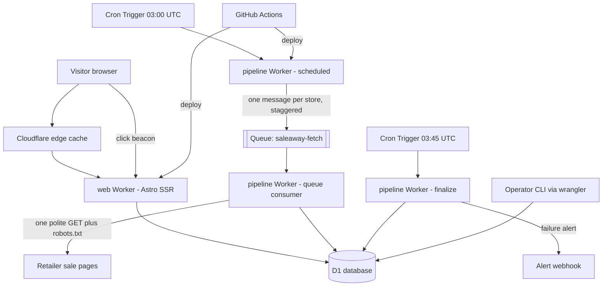

# High Level Architecture

## Technical Summary

Saleaway is a serverless system on Cloudflare's free tier, with two Workers sharing one D1 (SQLite) database in a TypeScript monorepo. A pipeline Worker runs once a day from a Cron Trigger, puts one message per store on a queue, and a queue consumer fetches, validates and extracts each store's discount politely and in isolation, writing a small fact record to D1. A web Worker built with Astro reads D1 and server-renders the home page (category cards of store rows, plus the "Biggest discounts today" card), behind an edge cache. Operators manage the system with CLI commands rather than an admin web app. The architecture fits the PRD's 3-day, no-budget constraints and keeps a clear path to scale.

## Platform and Infrastructure Choice

**Options considered**

1. **Cloudflare Workers + D1 + Queues (recommended).** Matches your hosting preference, free tier covers the MVP, one vendor, edge-served pages. Constraint: 10 ms CPU per invocation.
2. **Vercel + Supabase.** Easy Next.js hosting, but cron and function limits on free tiers are tight, and you asked for Cloudflare.
3. **Cloudflare Workers Paid ($5 a month).** Same design with far higher CPU and request limits. Not needed unless Risk R1 or R3 happens, and it is the clean escape hatch.

**Platform:** Cloudflare (Workers, D1, Queues, Web Analytics).
**Key Services:** Workers (web and pipeline), D1, Queues, Cron Triggers, Workers Logs, Web Analytics, GitHub Actions for CI/CD.
**Deployment Host and Regions:** Cloudflare's global edge. D1 primary location set to the closest region to South Africa that Cloudflare offers (a location hint, to be confirmed at database creation).

## Repository Structure

**Structure:** Monorepo.
**Monorepo Tool:** pnpm workspaces. No Nx or Turborepo, since there are only three packages.
**Package Organization:** `apps/web` (Astro site), `apps/pipeline` (cron and queue Worker), `packages/core` (pure, tested logic shared by both: validation, extraction, ranking, visibility rules and types), plus `db/` for migrations and seed data and `scripts/ops/` for operator commands.

## High Level Architecture Diagram

## Architectural Patterns

- **Serverless, event-driven fan-out:** cron enqueues, a consumer handles one store per invocation. _Rationale:_ stays inside the 50-subrequest and 10 ms CPU limits and isolates failures (NFR4).
- **Shared pure core package:** validation, extraction, ranking and visibility are plain functions with no I/O. _Rationale:_ testable with saved page samples (NFR12) and reusable by the web and pipeline Workers.
- **Strategy pattern per store:** `extraction_method` in the Retailers table picks the extractor. _Rationale:_ stores differ, and changing a store's method is a data change, not a release (FR3).
- **Facts only, no content copy:** the database stores name, URLs, percentage and timestamps. _Rationale:_ NFR7 legal safety.
- **Cache-aside at the edge:** home page HTML cached for minutes. _Rationale:_ protects the 5 million row-read and 100,000 request daily limits and meets the 2 second goal (NFR2).
- **Overrides as data:** manual values live in their own table and win at read time. _Rationale:_ the pipeline can never overwrite an operator's decision (FR12).
- **Computed visibility:** hiding stale or ended stores is done when reading, not by deleting rows. _Rationale:_ nothing is lost, and rules are unit-testable (Story 2.3).
- **CLI for operations:** no admin web UI. _Rationale:_ no extra attack surface and less to build in 3 days.
