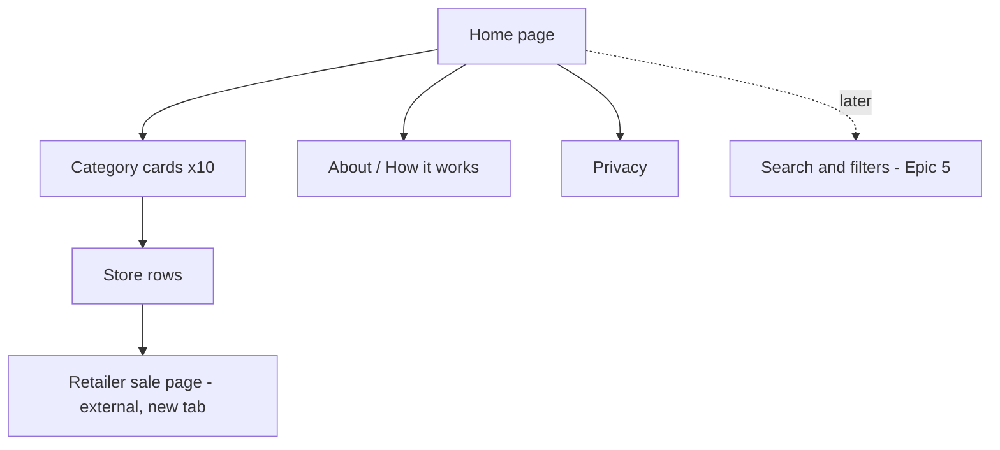
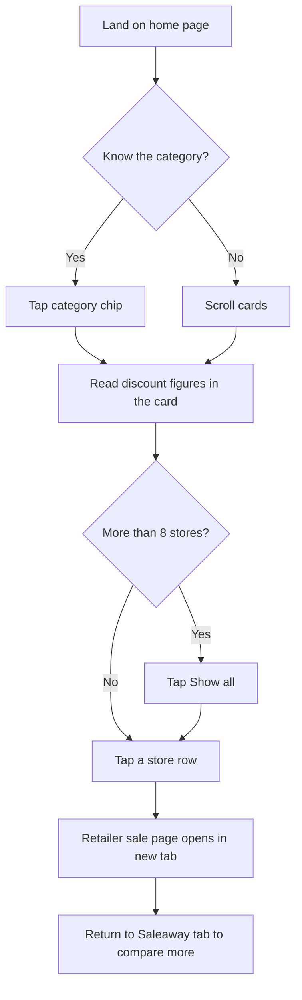

# Saleaway UI/UX Specification

_Drafted by the UX Expert agent (Sally) from `docs/prd.md`, `docs/brief.md` and the bored.com design reference supplied on 2026-10-28. Drafted in one pass rather than section by section. Items marked **[Assumption]** or **[Decision needed]** need your confirmation._

This document defines the user experience goals, information architecture, user flows, and visual design specifications for Saleaway's user interface. It serves as the foundation for visual design and frontend development, ensuring a cohesive and user-centered experience.

## Overall UX Goals & Principles

### Target User Personas

- **The Bargain Hunter (primary):** a South African online shopper, usually on a phone, who wants to know "who has a sale right now and how big is it?" They compare a few stores and leave quickly.
- **The Browser by Category:** someone who already knows what they want (for example sneakers or a TV) and only checks stores in that category.
- **The Operator (not public):** the site owner, who uses a command line and a protected report. No operator UI is designed here.

### Usability Goals

- **Speed to value:** a visitor sees a real discount figure without scrolling on a phone or desktop.
- **Three clicks or fewer** from landing to a retailer's sale page (PRD goal). The target is one click from the home page.
- **Scannability:** every store looks the same, so the eye can compare discounts down a list.
- **Trust:** every row says how fresh its data is, and ended sales never appear.
- **Fast:** under 2 seconds to first useful content on a South African mobile connection (NFR2).

### Design Principles

1. **One click to the sale.** The home page is the product. No sign-up, no detours, and every row opens the store's own sale page.
2. **The discount is the hero.** The percentage is the loudest thing in each row, bolder than the store name.
3. **One pattern, repeated.** Every category uses the same card and every store the same row, so a long catalogue stays scannable.
4. **Playful, not noisy.** Neo-brutalist character in the borders, shadows and colours, but quiet motion and no clutter.
5. **Accessible by default.** WCAG AA contrast, keyboard use and reduced-motion support are built in, not added later.

### Change Log

| Date | Version | Description | Author |
|---|---|---|---|
| 2026-10-28 | 0.1 | First draft from PRD and bored.com reference | Sally (UX) |
| 2026-10-28 | 0.2 | Decisions applied: discount-first order, "Biggest discounts today" sticker card is in scope, terminology confirmed | Sally (UX) |

## How the bored.com reference is used

**What we borrow:** the visual language (thick black outlines, hard offset shadows, flat colour, heavy headings, a cream background), the repeated list-card pattern with count badges, pill-style category chips, and one "sticker" card that breaks the grid.

**What we do not borrow:** the bored.com name, pumpkin mascot, logo, fun-fact ticker copy, taglines and games. Saleaway needs its own identity, and copying another brand's artwork or text would be a legal and trust risk.

**What we change because Saleaway is different:**

- Bored.com is about fun, so its density is a feature. Saleaway is about comparing numbers, so rows are slightly taller and the discount is the focus.
- The reference's own assessment lists issues, and this spec applies those fixes from the start: 8 rows per card by default, no ticker that auto-scrolls, contrast checked, and truncated names wrap to two lines.
- The assessment suggests real favicons to tell rows apart. **We do not use retailer favicons or logos** (PRD NFR7: text-only, to reduce legal and trademark risk). Rows are told apart by the store name and a category colour tab on each card instead.
- Mood chips and mini-games are not in the PRD and are not included.

## Information Architecture (IA)

### Site Map / Screen Inventory



The operator health report is a private page and is not part of the public site map.

### Navigation Structure

**Primary Navigation:** a slim header with the Saleaway wordmark on the left and two links: Categories (jumps to the category chips) and How it works.

**Secondary Navigation:** a row of category chips directly under the header, one per category, each jumping to that category's card. On mobile the row scrolls sideways and sticks below the header. The footer repeats About and Privacy.

**Breadcrumb Strategy:** none. The site is one page plus three small pages, so a Home link in the header is enough.

## User Flows

### Browse sales and visit a store

**User Goal:** find a store with a good sale and go to its sale page.

**Entry Points:** search engine result, a shared link, direct visit.

**Success Criteria:** the visitor opens a retailer's sale page from a row in one click.



**Edge Cases & Error Handling:**

- No data or database error: show a friendly full-width message ("Sales are loading, check back soon") instead of an empty page.
- A category with no visible stores is not shown, and its chip is removed.
- A store with an unknown discount shows "On sale" (outlined pill) and is still clickable.
- Data older than 72 hours is not shown (PRD FR10). A store older than 24 hours shows "Checked N days ago" in a warning style.
- The retailer's page is blocked or has ended since the last check: the link still opens the retailer's own site, which is outside our control. The About page says so.
- JavaScript is off: all rows are still in the page and all links work. "Show all" is a native `<details>` element.

**Notes:** the new-tab behaviour keeps Saleaway open so the visitor can compare stores.

### Retailer asks to be removed (dropped 2026-10-30)

There is no Contact page and no removal route. A store that does not want to be read says so in its `robots.txt`, which the pipeline obeys, and the operator can hide any store at once. The old `/contact` address, which the bot's user-agent carries, forwards to the "Our bot" part of the About page, which says what the bot is and how it behaves.

## Wireframes & Mockups

**Primary Design Files:** none yet. This spec is the source of truth. A ready-to-paste prompt for tools such as v0 can be generated with `*generate-ui-prompt` once this spec is approved.

### Key Screen Layouts

#### Home page, desktop (1280px content width)

**Purpose:** let a visitor compare current sales across all stores at a glance.

**Key Elements:**

```
+--------------------------------------------------------------------+
| SALEAWAY   Categories  How it works                        [ search* ] |  header
+--------------------------------------------------------------------+
| ** 63 stores on sale today   *   Updated today 06:10          [x] |  status strip (static)
+--------------------------------------------------------------------+
|  Every SA sale. One page.                                          |
|  We check South African stores every day, so you don't have to.    |
|  (Fashion) (Sport) (Tech) (Home) (DIY) (Beauty) (Grocery) (Kids)... |  category chips
+--------------------------------------------------------------------+
| [Advertisement - leaderboard 728x90]                               |
+--------------------------------------------------------------------+
| BIGGEST DISCOUNTS TODAY (pink-shadow sticker card, first in grid)  |
| 1 Bash - Fashion   [Up to 70% off]   2 Under Armour SA - Sport ... |
+--------------------------------------------------------------------+
| Marketplaces        [9]| Fashion & apparel   [8]| Sport         [11]|
| "Everything stores"    | "Wardrobe refresh"     | "Gear up for less"|
| 1 Takealot             | 1 Bash                 | 1 Under Armour SA |
|   Checked today        |   Checked today        |   Checked today   |
|            [Up to 60% off]         [Up to 70% off]       [Up to 50% off] |
| 2 Makro        [On sale]| 2 Mr Price   [On sale] | 2 ...             |
| ...  (8 rows)          | ...                    | ...               |
| Show all 9  v          | Show all 8  v          | Show all 11  v    |
+------------------------+------------------------+-------------------+
| (next row of cards, in a masonry grid; one ad card in the grid)    |
+--------------------------------------------------------------------+
| Footer: About - Privacy - (c) Saleaway                             |
+--------------------------------------------------------------------+
```

*Search is not part of the MVP (it arrives with Story 5.3), so the header leaves space and shows nothing for it at launch.

**Interaction Notes:** the grid is a masonry layout of category cards (3 columns on desktop, 4 on wide screens). Tapping a row opens the store's sale page in a new tab. Hover and keyboard focus lift the row and strengthen its shadow.

**Design File Reference:** none yet.

#### Home page, mobile (360 to 639px)

**Purpose:** same content, one thumb-friendly column.

**Key Elements:**

```
+------------------------------+
| SALEAWAY              [menu] |
+------------------------------+
| 63 stores on sale today   [x]|
+------------------------------+
| Every SA sale. One page.     |
| (Fashion)(Sport)(Tech)(Ho... | <- chips scroll sideways, stick under header
+------------------------------+
| Fashion & apparel        [8] |
| "Wardrobe refresh"           |
| 1 Bash                       |
|   Checked today [Up to 70%]  |
| 2 Mr Price      [On sale]    |
| ... (8 rows)                 |
| Show all 8  v                |
+------------------------------+
| [Advertisement 300x250]      |
+------------------------------+
```

**Interaction Notes:** rows are at least 48px tall with the full row tappable. The discount pill sits at the right and never wraps below the name on a 360px screen. If a long store name would crowd the pill, the name wraps to two lines.

**Design File Reference:** none yet.

## Component Library / Design System

**Design System Approach:** a small custom system built with CSS variables (design tokens), in the neo-brutalist style described below. No third-party component library is needed for about 8 components, and a small custom set keeps the page light for the 2-second goal. The Architect chooses the CSS tooling.

### Core Components

#### Category Card

**Purpose:** group the stores of one category into a scannable list.

**Variants:** standard (white, black shadow), "sticker" (rotated 1 degree with a pink shadow, used for the "Biggest discounts today" card, see below), ad card (see Ad Slot).

**States:** default, hover (card does not move; only its rows react), empty (not rendered), expanded (after "Show all").

**Usage Guidelines:** a 3px black border, a hard 6px offset black shadow, 20px padding. The header has the category title (heading level 2), a black square count badge (white numeral) showing the number of stores on sale in that category, and an italic tagline in quotes. A small category-colour tab on the left edge of the header tells cards apart. Shows 8 rows by default, then a "Show all N" control. The control appears on every card with more than 8 stores, and cards with 8 or fewer never show it.

#### "Biggest discounts today" Sticker Card

**Purpose:** give a visitor the best deals in one click.

**Variants:** one only. It is a category card with the "sticker" styling.

**States:** shown, hidden (when fewer than 3 stores have a known percentage).

**Usage Guidelines:** first card in the grid on every screen size, with a title such as "Biggest discounts today". It lists up to 8 stores, highest percentage first, ties broken by store rank. Each row is a normal store row plus the store's category name in small text under the store name (in place of the "Checked" line's position, with the checked time kept in the row's accessible name). Stores with only "On sale" are never listed. The card has no "Show all" control. The rotation is removed on mobile and when reduced motion is on, but the pink shadow stays. The pink shadow is decorative only, and the card keeps a full ink border for contrast.

#### Store Row

**Purpose:** show one store's sale and send the visitor to it.

**Variants:** with a known discount, with "On sale" only, stale (older than 24 hours).

**States:** default, hover, focus-visible, pressed, visited (a subtle tint on the store name only).

**Usage Guidelines:** the row is one link. Anatomy: rank number (muted grey), store name (semibold, wraps to two lines, never truncated with an ellipsis), small "Checked today" line, discount pill on the right, chevron. Opens in a new tab with `rel="noopener"`. The link's accessible name reads, for example, "Crocs SA, up to 50% off, checked today, opens in a new tab".

#### Discount Pill

**Purpose:** make the discount the most visible thing on each row.

**Variants:**

- **Up to X% off, 50% or more:** pink fill, black text, 2px black border.
- **Up to X% off, below 50%:** yellow fill, black text, 2px black border.
- **On sale (no figure):** white fill, black text, 2px dashed black border, to show it's less specific.

**States:** static. It is not a separate link.

**Usage Guidelines:** the number is always in the text, so colour is never the only signal. The text is in the heading font, bold, with "Up to" in smaller type.

#### Category Chip

**Purpose:** jump to a category.

**Variants:** default, active (the card currently in view).

**States:** default, hover, focus-visible, active.

**Usage Guidelines:** a pill with a 2px black border and the category name, as a link to the card's anchor. Minimum 44px tall. On mobile they sit in a horizontally scrolling, sticky row.

#### Status Strip

**Purpose:** show freshness and scale ("63 stores on sale today. Updated today 06:10").

**Variants:** default, dismissible.

**States:** shown, dismissed (remembered in local storage, with the page working if storage is blocked).

**Usage Guidelines:** amber background, black text, bold uppercase, star divider, full width. It is **static, not a scrolling marquee**, so it has no motion to pause.

#### Ad Slot

**Purpose:** hold advertisements once an ad network approves the site.

**Variants:** leaderboard (below the hero), in-grid card (between category cards), footer banner.

**States:** off (renders nothing and keeps no space), on (renders the ad inside a frame).

**Usage Guidelines:** always labelled "Advertisement" in small caps. The frame has a thin dashed border so it can't be mistaken for a store row. The slot reserves its size to prevent layout shift (PRD Story 2.5). An ad never sits inside a category card's list.

#### Header and Footer

**Purpose:** wayfinding and legal links.

**Variants:** desktop (inline links), mobile (menu button opening a full-width list).

**States:** default, menu open.

**Usage Guidelines:** a 3px black bottom border. The footer holds About, Privacy and a one-line disclaimer ("Discounts are read automatically and may change. Check the store's page before you buy.").

#### Empty / Error Message

**Purpose:** friendly fallback when no data is available.

**Variants:** no data, loading failed.

**States:** static.

**Usage Guidelines:** a full-width card using the standard card style, short text and no technical detail.

## Branding & Style Guide

### Visual Identity

**Brand Guidelines:** none supplied. This spec proposes an identity. A simple text wordmark "Saleaway" in the heading font with a small starburst mark is enough for launch. A logo can be designed later.

### Color Palette

All text pairings were checked against WCAG AA (4.5:1 for normal text). Ratios in the last column were calculated, not estimated.

| Color Type | Hex Code | Usage |
|---|---|---|
| Primary (ink) | #111111 | Text, borders, hard shadows, count badges (18.9:1 on white) |
| Secondary (sale yellow) | #FFD23F | Discount pill under 50%, status strip (13.1:1 with ink text) |
| Accent (hot pink) | #FF4F8B | Discount pill 50% or more, sticker card shadow (6.1:1 with ink text) |
| Accent 2 (sky blue) | #7CC4FF | Header search shadow, decorative highlights (10.1:1 with ink text) |
| Success (mint) | #A8E6B0 | "Checked today" tick or highlight, confirmations (13.1:1 with ink text) |
| Warning | #FFD23F with a "Checked N days ago" label | Stale data notice (text is ink, so contrast stays 13.1:1) |
| Error | #FF4F8B with ink text | Error message frames (6.1:1) |
| Neutral | Page #FAF6EC, surface #FFFFFF, muted text #4A4A4A (8.9:1), subtle text #6B6B6B (5.3:1 on white, 4.9:1 on cream) | Backgrounds, secondary text, rank numbers, chevrons |
| Focus | #1A4FFF | Focus outline, 3px (5.4:1 on cream, 5.8:1 on white) |

**Notes:** pink on cream is only 2.9:1, so pink is never used for text or as the only boundary of a control. Controls are always outlined in ink. The reference's light-grey rank numbers and chevrons failed this kind of check, so they use #6B6B6B instead.

### Typography

#### Font Families

- **Primary (headings and discount figures):** Space Grotesk, bold, as a heavy geometric sans similar to the reference **[Assumption]**. The Architect may swap it for another free heading font if load time suffers.
- **Secondary (body and rows):** the system UI font stack, so body text costs no download.
- **Monospace:** not used.

Load at most one web font family with `font-display: swap`, subsetted to Latin (NFR2).

#### Type Scale

| Element | Size | Weight | Line Height |
|---|---|---|---|
| H1 | 40px mobile, 56px desktop | 700 | 1.05 |
| H2 (category title) | 24px | 700 | 1.2 |
| H3 | 18px | 700 | 1.3 |
| Body (store name) | 16px | 600 | 1.4 |
| Small (checked line, tagline, rank) | 13px | 400, taglines italic | 1.4 |
| Discount pill figure | 18px | 700 | 1 |

### Iconography

**Icon Library:** a small inline SVG set (chevron, external link, shuffle, close, menu, star), around six icons, so no icon font is needed.

**Usage Guidelines:** icons are decorative only and are hidden from screen readers. Anything they stand for is also in text. No retailer logos or favicons are used (PRD NFR7).

### Spacing & Layout

**Grid System:** CSS grid or columns masonry for the category cards. Content width capped at 1280px and centred, with a 16px gutter on mobile and 24px on larger screens. A faint dot pattern shows in the side gutters on wide screens only.

**Spacing Scale:** 4px base unit: 4, 8, 12, 16, 24, 32, 48. Borders 3px (cards) and 2px (pills, chips). Hard shadow offsets 4px (small elements) and 6px (cards), with no blur.

## Accessibility Requirements

### Compliance Target

**Standard:** WCAG 2.2 AA.

### Key Requirements

**Visual:**

- Color contrast ratios: 4.5:1 for text and 3:1 for UI boundaries, per the palette table. Ink outlines supply the 3:1 boundary for every control.
- Focus indicators: a 3px solid #1A4FFF outline with 2px offset on every interactive element, never removed.
- Text sizing: the smallest text is 13px, and the page stays usable at 200% zoom and with larger system fonts. No text is stored as an image.

**Interaction:**

- Keyboard navigation: logical tab order, header then chips then cards then rows. "Show all" is a native `<details>` or button with `aria-expanded`. A "Skip to sales" link is the first focusable element.
- Screen reader support: one `<main>`, a heading per category (H2), lists as real `<ol>` elements, and row links with descriptive names. The count badge is read as "N stores on sale".
- Touch targets: at least 44px by 44px for every row, chip and control, and at least 8px between targets.

**Content:**

- Alternative text: decorative icons are hidden, and there are no informative images.
- Heading structure: H1 once (hero), H2 per category, no skipped levels.
- Form labels: the MVP has no forms. When search arrives, it gets a visible or properly associated label.

### Testing Strategy

Automated checks (axe or Lighthouse) in CI, a keyboard-only pass of the home page, a screen reader spot check (VoiceOver on iPhone and Mac), and a 200% zoom check, all before launch.

## Responsiveness Strategy

### Breakpoints

| Breakpoint | Min Width | Max Width | Target Devices |
|---|---|---|---|
| Mobile | 320px | 639px | Phones |
| Tablet | 640px | 1023px | Large phones, small tablets |
| Desktop | 1024px | 1439px | Laptops, desktops |
| Wide | 1440px | - | Large monitors |

### Adaptation Patterns

**Layout Changes:** 1 column on mobile, 2 on tablet, 3 on desktop, 4 on wide (content still capped at 1280px, so wide mostly adds gutter).

**Navigation Changes:** header links collapse into a menu button below 640px. The category chip row becomes horizontally scrollable and sticky on mobile.

**Content Priority:** on mobile the order is header, status strip, hero line, chips, then cards. The hero paragraph is hidden below 640px so the first card is above the fold. Ad slots sit between cards, never above the first card on mobile.

**Interaction Changes:** hover effects apply only on devices that can hover. Touch devices rely on a pressed state.

## Animation & Micro-interactions

### Motion Principles

Motion is small and quick, and only confirms an action. Nothing moves on its own: there is no marquee, auto-playing animation or looping effect. All movement is disabled when the visitor has `prefers-reduced-motion` set.

### Key Animations

- **Row hover and focus:** the row shifts 2px up and left and its shadow grows from 4px to 6px (Duration: 120ms, Easing: ease-out). Replaced by a colour change only when reduced motion is on.
- **Row pressed:** the row moves back to its resting position (Duration: 80ms, Easing: ease-in).
- **Show all:** the card expands in place (Duration: 150ms, Easing: ease-out), and with reduced motion it expands instantly.
- **Status strip dismiss:** fades out (Duration: 150ms, Easing: ease-out).

## Performance Considerations

### Performance Goals

- **Page Load:** first content in under 2 seconds on a typical South African mobile connection (NFR2), with Lighthouse mobile performance of 90 or more (Story 2.4).
- **Interaction Response:** under 100ms for any tap or key response.
- **Animation FPS:** 60 where animation runs, using only transform and opacity.

### Design Strategies

Server-render the home page and cache it at the edge so content exists without JavaScript. Use no images except inline SVG. Load at most one web font, subsetted. Reserve space for ad slots to avoid layout shift. Keep JavaScript to the small pieces that need it (status strip dismiss, active chip highlight).

## Open Decisions

**Decided on 2026-10-28**

1. **Row order within a category:** biggest known discount first. "On sale" stores follow, ordered by store rank, and ties are broken by rank (PRD FR14, Story 2.2).
2. **"Biggest discounts today" sticker card:** in scope. It is the first card in the grid, listing the 8 deepest discounts across all stores (PRD FR23, Story 3.7). It depends on extracted percentages, so it is built in Epic 3 and hidden until at least 3 stores have a known percentage.
3. **Terminology:** a "card" is one category card, containing a "row" per store. The PRD has a note explaining this.

**Still open**

4. **[Assumption] Heading font** is Space Grotesk. A different free font is fine.
5. **Not designed here:** search results, category filters (Epic 5), the operator report, and any logo artwork.

## Next Steps

### Immediate Actions

1. Review this spec, especially the three decisions above.
2. Run `*generate-ui-prompt` to create a prompt for v0 or Lovable if you want a visual prototype before building (optional).
3. Hand off to the Architect for the full-stack architecture, using this spec and the PRD.
4. Run the contrast and keyboard checks again on the built page.

### Design Handoff Checklist

- [x] All user flows documented
- [x] Component inventory complete
- [x] Accessibility requirements defined
- [x] Responsive strategy clear
- [x] Brand guidelines incorporated (proposed, since none exist)
- [x] Performance goals established

## Checklist Results

No UI/UX checklist exists in `.bmad-core/checklists/`, so none was run.
